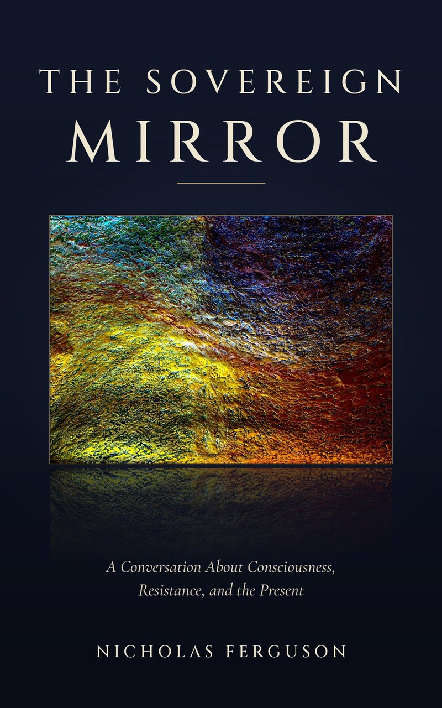

# The Theory of Sovereign Reflectivity (TSR)

TSR is a way of seeing consciousness that starts from one rule: **the main difference between the physical and the nonphysical is resistance.** Reflect what physics already knows, keep each relationship, flip the condition, and the other side comes into view.

This repository is where the theory is shared openly. It holds a free sample of the book and a few extras.

## 📖 The book: *The Sovereign Mirror* (2026)

*The Sovereign Mirror: A Conversation About Consciousness, Resistance, and the Present* explains TSR as a conversation. A curious, skeptical questioner asks what anyone would ask, and I answer with the stories behind each idea: a quiet voice on a basketball court, the hot seat on the last day of a cruise, journal entries carved into oil pastel with a knife, and a son who seemed to grow up overnight after a fever.

- **Read the opening free:** [`tsr.md`](tsr.md) has the opening note, the prelude, and Chapter 1.
- **Kindle:** [amazon.com/dp/B0HL1YBX5K](https://www.amazon.com/dp/B0HL1YBX5K)
- **Paperback:** [amazon.com/dp/B0HL4TQ5RK](https://www.amazon.com/dp/B0HL4TQ5RK)
- **About the book:** [njf.io/books/the-sovereign-mirror](https://www.njf.io/books/the-sovereign-mirror)

You don't have to believe any of it to try it.

## 🎲 Run the game yourself

[`reflection-game.md`](reflection-game.md) is a prompt you can paste into Claude, ChatGPT or Gemini to test TSR the hard way. I don't think another table of reflections holds together like this one. Try to build one that does: different words, the same rule, as many connections and as much sense, or more. Or warm up by reflecting one new piece of physics. The prompt carries the table, what holds each word in place, the three tests, the traps I fell into, and the swaps that failed. If you end up somewhere I didn't, [open an issue](https://github.com/njfio/tsr/issues) and tell me.

## 🔬 Read it deep with an AI

[`deep-read.md`](deep-read.md) is a prompt that takes an AI all the way into TSR in ten passes: the physics under each row first, then the reflection, then the web of connections, with a second look after every pass. It carries the book's own answers to the questions a first read raises, so it works without the book; with the book, it goes further. The live copy is at [tsr.wtf/deep-read](https://tsr.wtf/deep-read). When it turns something up, a tear, a candidate row or a connection, [file it here](https://github.com/njfio/tsr/issues/new/choose).

Before you file a tear, check [Hard questions, answered](https://tsr.wtf/answers): most first objections are answered in the book, in its own words. AI assistants that can browse can read everything at once in [tsr.wtf/llms-full.txt](https://tsr.wtf/llms-full.txt).

## 🪞 TSR in brief

These are the ideas the book builds, in its own words.

- **Awareness first.** Instead of trying to build awareness out of matter, TSR starts with awareness and asks what follows. The parts are how the whole gets to experience difference.
- **Two environments, mirror images.** The physical is limited, resistant, and radiates. The nonphysical is limitless, receptive, and collects. Everything else in TSR comes from what happens where they meet.
- **Resistance isn't the enemy.** Resistance is why you're a particular someone: a body that stays yours and a point of view nobody else can stand in. The kind that hurts is *holding on*, which keeps you from changing when a change is already wanted.
- **The Current of Consciousness.** The nonphysical side is like a river in laminar flow, so smooth it looks idle while it moves the entire time. It's always the furthest point the whole has reached, and everyone's expansion moves it.
- **Sovereignty.** Each of us is fully inside the whole *from somewhere*, and nobody else gets to be there. That's also why the other person is always real, and why nothing I want entitles me to their place in the flow.
- **Einstein, reflected.** The book mirrors relativity: E = mc² on the physical side and its reflection on the nonphysical side, with the Current in place of the speed of light. I'm not a physicist; I use the shape of his thinking to look at the other side of it.
- **A practice, not a creed.** Tune before you focus, notice what you feel, and test it against your own life.

## 🧪 Testing TSR the hard way

I don't think a reflection table only counts because its author likes how it sounds. This repository carries two independent test suites—neither proves anything about the physical world (as *The Sovereign Mirror* says upfront, the table borrows the shape of physics, not its authority), and both report what pushed back right alongside what held:

- **[Machine-checked proofs](proof/PROOF.md) (`proof/`):** Formalizes TSR's structure in `Lean 4` (`35` verified items, `0 sorry`), tests slot and graph uniqueness in `Z3` (`S_29` automorphism cascade `12 -> 2 -> 1` and `21` minimal `UNSAT` cores on hand-encoded rules), audits the 80-word etymology ledger from *What the Words Knew* in exact rational arithmetic (where the single pre-declared primary test is a null result: `1/16` overlap, `p = 0.2878`), and verifies a `15/15` mutation audit in Linux CI.
- **[Preregistered multi-AI evaluations](harness/RESULTS.md) ([`harness/`](harness/RESULTS.md) & [`deep_v3`](harness/deep_v3/RESULTS_DEEP_V3.md)):** Tested across 6 AI model families in `v2` (5 generators/raters + DeepSeek opponent; 5 in `deep_v3`) on 40 unseen OpenStax physics equations, the 14-slot multi-job web, the Crossing regime, and verbatim Chapter 2 prose without leaking answers:
  - **What held:** Core mechanics, waves, and relativity laws separated cleanly from thermodynamic, fluid, and sound boundaries (`16/28` Core vs. `0/12` Boundary), and multi-job web constraints favored TSR's words `13/14` over Chapter 16 synonyms and `14/14` over challengers and shuffled controls (plus `11/12` on masked book excerpts). Adding the Crossing rule (`pressure -> felt gap`) separated mechanical Crossing laws (`5/7` strict, `7/7` valid-voter) from `0/13` non-Crossing boundaries, and Layer-A v3 cleared `16/16` equations cleanly on TSR's terms while shuffled `A3-1` still collided.
  - **What pushed back honestly:** Cold vocabulary-free guessing hit exact Book words only `6.7%` of the time (`4/60`), single-equation zero-glossary judging rarely verified law structure without a partner key (`3/16`), in `D1b`'s joint 4-criteria boolean truth tables (`all4`) zero rival terms qualified on any single slot (`0/14`) while literal isolated readings of criterion `c1` (plus `c3` on `W07`) held back `4` Book slots (`W01, W02, W07, W10`) so the joint `all4` solver returned `0` complete 14-slot assignments without surrounding context, and supplying verbatim Chapter 2 prose without Chapter 16's boundary clarifications lowered calibration consensus from `12/17` to `8/17` (pooled `62/85 -> 48/85`), driving `F = ma` (`K16`) from `2/5` to `5/5` `invert` alongside `K06` (`4/5 -> 5/5` `invert`) and `K05` (`4/5 -> 4/5` `invert`) and losing quorum on `K04, K07, K08, K11`.

## 📚 What's in this repository

| Path | What it is |
|---|---|
| [`tsr.md`](tsr.md) | Free sample of *The Sovereign Mirror* (2026): opening note, prelude, and Chapter 1 |
| [`reflection-game.md`](reflection-game.md) | The Reflection Game: prompt for testing TSR's table or reflecting new physics with any AI |
| [`deep-read.md`](deep-read.md) | The Deep Read: ten-pass prompt walking an AI through the physics and the mirror |
| [`proof/`](proof/PROOF.md) | Machine-checked formalization: Lean 4 theorems, Z3 uniqueness, exact etymology math, and `15/15` mutation audit |
| [`harness/`](harness/RESULTS.md) | Preregistered evaluation across 6 AI model families on 40 unseen OpenStax equations (`v2`: 5 generators/raters + DeepSeek opponent) and 5-AI web/Crossing/prose diagnostics ([`deep_v3`](harness/deep_v3/RESULTS_DEEP_V3.md)) |
| [`tests/`](tests/) | Earlier tests of the one rule: a formal model, a 5-AI extension test, and masked round-2 ratings, with results and open questions |
| [`audio/the-universe-as-reflection.mp3`](audio/the-universe-as-reflection.mp3) | Audio recording: *The universe as reflection* |
| [`the-sovereign-mirror/`](the-sovereign-mirror/) | Cover art for the book |

## 🤝 How it was written

*The Sovereign Mirror* was written with AI as a collaborator. I explained TSR in conversation, again and again, until the questions stopped breaking the picture. The questions are real ones, and the answers are mine. The text was drafted with Claude (Anthropic) and edited extensively over many revisions.

## 💬 Get involved

- Found a tear, a candidate row or a connection? [File it](https://github.com/njfio/tsr/issues/new/choose); there's a form for each.
- Questions, disagreements, and connections to other traditions are welcome: [open an issue](https://github.com/njfio/tsr/issues).
- Companion site: [tsr.wtf](https://tsr.wtf)
- Updates: @njfdotio · @tsr_wtf · [LinkedIn](https://www.linkedin.com/in/njfio/) · [njf.io](https://www.njf.io)

## 📜 License

- *The Sovereign Mirror* sample and cover art: **CC BY-NC-ND 4.0**, meaning share it unchanged, with credit, non-commercially. See [`LICENSE-BOOK.md`](LICENSE-BOOK.md). The full book is © 2026 Nicholas Ferguson, all rights reserved.
- Everything else: **MIT License**. See [`LICENSE`](LICENSE).
