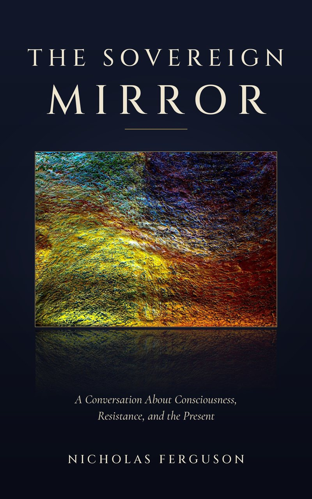

# The Theory of Sovereign Reflectivity (TSR)

TSR is a way of seeing consciousness that starts from one rule: **the main difference between the physical and the nonphysical is resistance.** Reflect what physics already knows, keep each relationship, flip the condition, and the other side comes into view.

This repository is where the theory is shared openly. It holds a free sample of the book and a few extras.

## 📖 The book: *The Sovereign Mirror* (2026)

*The Sovereign Mirror: A Conversation About Consciousness, Resistance, and the Present* explains TSR as a conversation. A curious, skeptical questioner asks what anyone would ask, and I answer with the stories behind each idea: a quiet voice on a basketball court, the hot seat on the last day of a cruise, journal entries carved into oil pastel with a knife, and a son who seemed to grow up overnight after a fever.

- **Read the opening free:** [`tsr.md`](tsr.md) has the opening note, the prelude, and Chapter 1.
- **Kindle:** [amazon.com/dp/B0HL1YBX5K](https://www.amazon.com/dp/B0HL1YBX5K)
- **Paperback:** [amazon.com/dp/B0HL4TQ5RK](https://www.amazon.com/dp/B0HL4TQ5RK)
- **About the book:** [njf.io/books/the-sovereign-mirror](https://www.njf.io/books/the-sovereign-mirror)

You don't have to believe any of it to try it.

## 🎲 Run the game yourself

[`reflection-game.md`](reflection-game.md) is a prompt you can paste into Claude, ChatGPT or Gemini to test TSR the hard way. I don't think another table of reflections holds together like this one. Try to build one that does: different words, the same rule, as many connections and as much sense, or more. Or warm up by reflecting one new piece of physics. The prompt carries the table, what holds each word in place, the three tests, the traps I fell into, and the swaps that failed. If you end up somewhere I didn't, [open an issue](https://github.com/njfio/tsr/issues) and tell me.

## 🪞 TSR in brief

These are the ideas the book builds, in its own words.

- **Awareness first.** Instead of trying to build awareness out of matter, TSR starts with awareness and asks what follows. The parts are how the whole gets to experience difference.
- **Two environments, mirror images.** The physical is limited, resistant, and radiates. The nonphysical is limitless, receptive, and collects. Everything else in TSR comes from what happens where they meet.
- **Resistance isn't the enemy.** Resistance is why you're a particular someone: a body that stays yours and a point of view nobody else can stand in. The kind that hurts is *holding on*, which keeps you from changing when a change is already wanted.
- **The Current of Consciousness.** The nonphysical side is like a river in laminar flow, so smooth it looks idle while it moves the entire time. It's always the furthest point the whole has reached, and everyone's expansion moves it.
- **Sovereignty.** Each of us is fully inside the whole *from somewhere*, and nobody else gets to be there. That's also why the other person is always real, and why nothing I want entitles me to their place in the flow.
- **Einstein, reflected.** The book mirrors relativity: E = mc² on the physical side and its reflection on the nonphysical side, with the Current in place of the speed of light. I'm not a physicist; I use the shape of his thinking to look at the other side of it.
- **A practice, not a creed.** Tune before you focus, notice what you feel, and test it against your own life.

## 📚 What's in this repository

| Path | What it is |
|---|---|
| [`tsr.md`](tsr.md) | Free sample of *The Sovereign Mirror* (2026) |
| [`reflection-game.md`](reflection-game.md) | The Reflection Game: try to build a table that holds together like TSR's, with any AI |
| [`tests/`](tests/) | Tests of the one rule: a formal model, an extension test run with five AIs, and a blind round, with results and open questions |
| `10-02 The universe as reflection..mp3` | Audio recording: *The universe as reflection* |
| [`the-sovereign-mirror/`](the-sovereign-mirror/) | Cover art for the book |

## 🤝 How it was written

*The Sovereign Mirror* was written with AI as a collaborator. I explained TSR in conversation, again and again, until the questions stopped breaking the picture. The questions are real ones, and the answers are mine. The text was drafted with Claude (Anthropic) and edited extensively over many revisions.

## 💬 Get involved

- Questions, disagreements, and connections to other traditions are welcome: [open an issue](https://github.com/njfio/tsr/issues).
- Companion site: [tsr.wtf](https://tsr.wtf)
- Updates: @njfdotio · @tsr_wtf · [LinkedIn](https://www.linkedin.com/in/njfio/) · [njf.io](https://www.njf.io)

## 📜 License

- *The Sovereign Mirror* sample and cover art: **CC BY-NC-ND 4.0**, meaning share it unchanged, with credit, non-commercially. See [`LICENSE-BOOK.md`](LICENSE-BOOK.md). The full book is © 2026 Nicholas Ferguson, all rights reserved.
- Everything else: **MIT License**. See [`LICENSE`](LICENSE).
