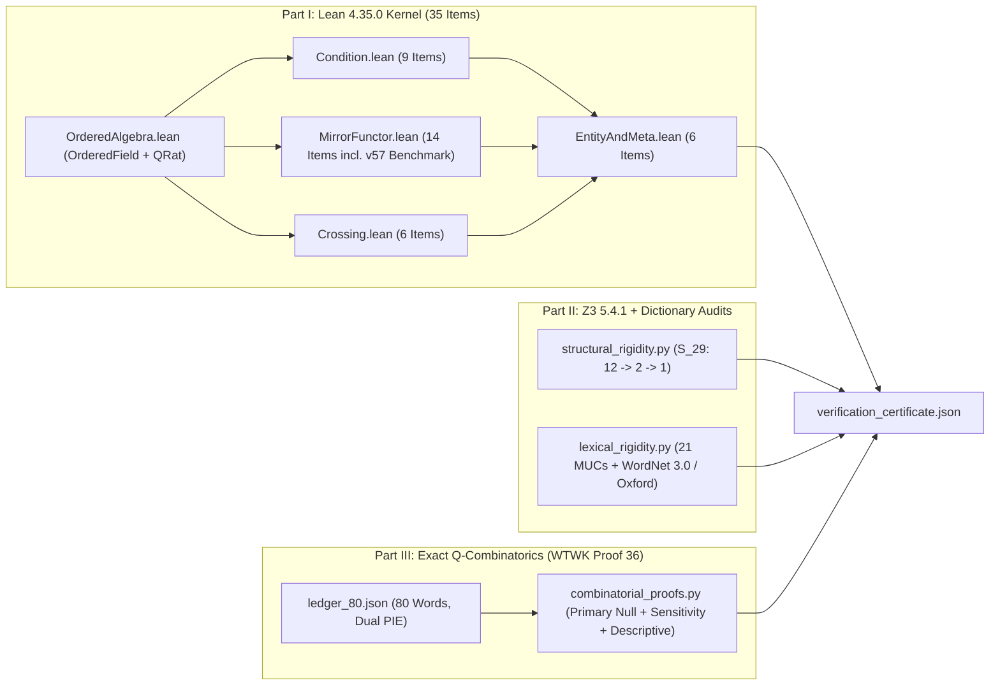

# Machine-Checked Formalization and Consistency Check of the Theory of Sovereign Reflectivity

**Primary Sources Audited**:
1. Nicholas Ferguson, *The Sovereign Mirror* (**v57**; *The Map*, pp. 172–176)
2. Nicholas Ferguson, *What the Words Knew* (**proof 36**, November 2026; *Every Word, for the Record*, pp. 99–104)

**Verification Suite**: [run_all_proofs.py](run_all_proofs.py) → [verification_certificate.json](verification_certificate.json)  
**Toolchains**: Lean 4 (`v4.35.0`, `0 sorry`, `0 Classical.choice`, nominal `PhysDim` / `NonphysRank` separation), Z3 SMT Solver (`v5.4.1`), Princeton WordNet 3.0 ([wordnet_100_synsets.json](z3/wordnet_100_synsets.json), SHA-256 verified) + Apple `CoreServices` New Oxford American Dictionary (with cross-platform WordNet 3.0 fallback on Linux), Python 3.12 Exact Rational Arithmetic (`fractions.Fraction`, `0` LLM calls).

---

## 0. Epistemic Contract & Removed / Weakened Claims

Before stating any machine-checked result, this suite draws an explicit boundary around what deductive logic, finite SMT checking, and combinatorial word counts establish — and what they do **not** establish. As *The Sovereign Mirror* states upfront (*v57*, Note p. 9):

> **The table borrows the shape of physics, not its authority.**

### 0.1 What Is Scoped Out (Not Proved)
1. **External Physical or Ontological Truth**: Machine-checked theorems prove what follows *conditional on chosen Lean structures and definitions*, or that those definitions admit a constructive rational witness (`canonicalTSRModel`). They do **not** establish from zero premises that consciousness exists independently, that the Map describes external physical law, or that a nonphysical medium is empirically real (*SM v57*, Ch. 21, p. 153).
2. **Physics Authority or Dimensional Equivalence**: TSR does **not** equate physical joules across $C^2 \times M = E = m \times c^2$, assign SI meters/seconds/kilograms to nonphysical terms, or derive physical constants (*SM v57*, Note p. 9, Ch. 2 p. 28, Ch. 17 p. 128). Structural analogies share algebraic form only.
3. **Modeling Choices Introduced in Code (`(c)` Items)**: Several quantitative formulas, AST categories, and synthetic dynamical laws in Lean — including the specific dilation ansatz $C_{\text{rate}} \cdot \frac{T_0}{T_0 + h}$, quadratic update increments $(x - s)^2$, `"reversible equilibrium"` encoding for Boyle's law, and identifier strings such as `hinge`, `barrier`, `temporal momentum`, and `twoRegionNoSharedE`/`threeRegionSharedE` — are **(c) formalization choices not stated in *v57***, and are flagged explicitly in [Section 1](#1-part-i--machine-checked-formalization-in-lean-4).
4. **Open Empirical & Domain Questions**: Unforced empirical claims (fever/illness Ch. 19 pp. 144–146, post-mortem continuation Ch. 20 pp. 147–151, planetary/ecosystem entity boundaries Ch. 18 p. 141) remain outside deductive claims.

### 0.2 Explicit Removed or Weakened Claims (PR Revision Transparency)
Compared to earlier drafts of this document and verification scripts, the following claims were explicitly **removed or weakened**:
1. **Rescoped Overall Claim**: Removed maximalist phrasing claiming external certainty or proof of physical/ontological truth; the suite is framed plainly as a **machine-checked formalization and consistency check**.
2. **Removed Physics-Authority Metaphors in Part II**: Removed all classical electromagnetism field-line and divergence metaphors from Stage S3 and `SLOT_REQUIREMENTS`; Stage S3 (`S3_plus_ch2_stationary_vs_returning_polarity`) now relies solely on *SM v57* Ch. 2 pp. 26–27 stationary vs. returning polarity, and the side-swap MUC tag is `thm_3_2_bottom_holding_on_resistance_only_on_P`.
3. **Disclosure of Hand-Written Inputs in Part II**: Part II no longer characterizes Z3 relation graphs, feature flags, or dictionary concept-groups as target-blind; [structural_rigidity.py](z3/structural_rigidity.py#L375-L383) and [lexical_rigidity.py](z3/lexical_rigidity.py#L1319-L1334) disclose directly that relation sets, `CANDIDATES`/`SLOT_REQUIREMENTS` flags, and per-slot keyword groups were **written by hand knowing the target words**. What Z3 checks is strictly: **no two terms in the Map, as encoded, are interchangeable**.
4. **Replacement of Confirmatory Etymology Overclaims in Part III**: Under the single **pre-declared primary test** (`g_tsr_oct22_cdba80d`, `66` pairs from Oct 22 commit `cdba80d` [tests/tsr_formal.py](../tests/tsr_formal.py), SHA-256 `075fd22b9e4a9b91fa76bc433e4a754ca5faf57009fa0c071158711fba918ae0`, vs. `pie_roots_strict`, `16` pairs over `N_orth_unrelated = 3,152`), there is **`1` overlapping pair (`distance–resist`) with exact hypergeometric $p = 0.2878$ — not statistically significant (null result)**. Earlier headlines featuring uncorrected Nov 13 graphs and exploratory `p < 0.05` cells are quarantined in [Section 3.2](#32-uncorrected-exploratory-sensitivity-analyses).
5. **Reclassification of Core-Law Directionality Ratios as Descriptive Only**: In [ledger_80.json](etymology/ledger_80.json), the 80 `kind` classifications (`family: 36`, `not used: 1`, etc.) were assigned by the author while drafting *What the Words Knew* (*proof 36*, pp. 99–104), not blind, and the `21 core_law` vs. `14 secondary_physics` partition is post hoc. All Fisher / binomial ratios in [Section 3.3](#33-descriptive-core-law-directionality-summary-post-hoc-not-inferential) are marked `DESCRIPTIVE_ONLY_POST_HOC_SPLIT_NOT_INFERENTIAL`.
6. **Accurate Pair Filtering Label**: Replaced the misleading `"blind"` label for the orthographic exclusion filter (`N_orth_unrelated = 3,152` strict / `3,153` legacy) with **"orthographically unrelated"** (`N_orth_unrelated`, `n_orth_unrelated_pairs`).
7. **Book Edition & Ledger Reconciliation**: Updated all references to *The Sovereign Mirror* **v57** and *What the Words Knew* **proof 36** (`pp. 99–104`), incorporating the 3 *proof 36* ledger diffs (`light` moved from `not used` to `family`, changing `worst_case_nonfamily_core_law` from `5/15` to `5/14`; `reflection` and `wave` text updates; shifted page numbers).



---

## 1. Part I — Machine-Checked Formalization in Lean 4

Source directory: [proof/lean/](lean) (`0 sorry`, `0 admit`, `0 custom axioms`, `0 Classical.choice`, `0 have _`; negative compile check rejects `def bad : TSR.PhysDim → TSR.NonphysRank := id`).

Every theorem below is quantified over `[OrderedField F]` ([OrderedAlgebra.lean](lean/TSR/OrderedAlgebra.lean#L21-L40), including `sub_nonneg_of_le` [#L195-L199](lean/TSR/OrderedAlgebra.lean#L195-L199) and `mul_left_cancel_pos` [#L254-L258](lean/TSR/OrderedAlgebra.lean#L254-L258)) and constructively inhabited on `QRat` ([#L499-L743](lean/TSR/OrderedAlgebra.lean#L499-L743)). Across all **35 verified items**: **15** use zero axioms (pure CIC), **13** depend only on `[propext]`, and **7** depend on `[propext, Quot.sound]`.

### 1.1 Explicit Classification Standard `(a)` / `(b)` / `(c)`

Every Lean theorem proves something exact, but for different reasons:
- **`(a)` Consequence of chosen definitions**: Deductively follows once the Lean structures/predicates are posited.
- **`(b)` Standard physics or algebra true regardless of TSR**: Ordinary ordered-field, group-theoretic, Newtonian, or relativistic algebra that holds independently of TSR.
- **`(c)` Modeling choice not in the book**: Quantitative equations, data encodings, or code labels added during Lean formalization that do not appear verbatim in *SM v57*. Hybrids such as **(a) over (c)** mean Lean proves `(a)` deductively about the chosen `(c)` model.

Specifically flagged as **`(c)` not in *SM v57***:
1. **Dilation formula $v_{\text{eff}} = C_{\text{rate}} \cdot \frac{T_0}{T_0 + h}$** ([cross_hinge_dilation_throttling](lean/TSR/MirrorFunctor.lean#L795-L844)) and the identifier word `hinge` (*v57* speaks of *The Present* / center rather than a `"hinge"` rate quotient).
2. **Squared-error state update rules $(x - s)^2$** in [predErrorSq](lean/TSR/EntityAndMeta.lean#L209-L210), [subgoalErrorSq](lean/TSR/EntityAndMeta.lean#L213-L214), [four_way_entity_separation](lean/TSR/EntityAndMeta.lean#L349-L498), [pairwiseContrast](lean/TSR/EntityAndMeta.lean#L703-L705), and [independence_of_first_partition](lean/TSR/EntityAndMeta.lean#L734-L760).
3. **`"reversible equilibrium"` encoding (`IsothermalEquilibriumBalance` / `reversibleStateEquilibrium`) for Row 17 (Boyle's law)** in [two_level_reading_theorem](lean/TSR/MirrorFunctor.lean#L626-L637). In *SM v57* Ch. 16, p. 118, Boyle's law stays `.Keep` for a different physical reason: **pressure exists only because walls hold something in; walls are resistance, so pressure can only exist where the two sides touch**, keeping the compressed pressure–volume relation unchanged when resistance is on.
4. **Formalization code labels not used as *v57* terms**: identifiers containing `hinge` (`cross_hinge_dilation_throttling`), `barrier` (`barrier`, `ResistanceWorkBarrier`, `countActiveBarriers`, `multiBarrierWorkRow`), `temporal momentum` (`physTemporalMomentum`, *cf. SM v57* Ch. 17 pp. 129–130), and `twoRegion` / `threeRegion` (`MirrorArchitecture.twoRegionNoSharedE` vs. `.threeRegionSharedE`; *SM v57* Ch. 16 p. 117 writes `"two sides"` vs. `"three: the two sides and the continuum where they meet, with one energy in it"`).

### 1.2 Complete 35-Item Classification Table

| # | Lean Identifier & Location | Kernel Axioms | Class | What Lean Actually Proves vs. What Is `(b)` or `(c)` |
|---:|:---|:---|:---|:---|
| 1 | [`condition_triad_equivalence`](lean/TSR/Condition.lean#L115-L129) | `none` | `(a) over (c)` | On a partitioned `(c)` `Medium` ([L75-L87](lean/TSR/Condition.lean#L75-L87)), modeled `Resistant ↔ Limited ↔ Radiating` via `rho > 0` / positive `barrier` & `transferCost`. |
| 2 | [`receptive_triad_equivalence`](lean/TSR/Condition.lean#L138-L169) | `[propext]` | `(a) over (c)` | `rho = 0` forces zero modeled `barrier`/`transferCost`, giving `Limitless ↔ Collecting` on partitioned `Medium`. |
| 3 | [`undivided_locus_triad`](lean/TSR/Condition.lean#L175-L196) | `none` | `(a) over (c)` | An undivided locus (`∀ x y, x = y`) forces zero `barrier`/`transferCost`, `Limitless`, and `Collecting` even when `rho > 0`. |
| 4 | [`damped_ripple_strict_decay`](lean/TSR/Condition.lean#L228-L252) | `none` | `(a)/(b) over (c)` | `(b)` Geometric-decay induction ($B_{n+1} = (1-\alpha)B_n < B_n$) over `(c)` discrete `PerturbationMedium` (`trajectory`). |
| 5 | [`zero_resistance_culmination`](lean/TSR/Condition.lean#L258-L285) | `none` | `(a)/(b) over (c)` | `(b)` Additive partial-sum accumulation $B_n = B_0 + \sum \xi_k$ when `rho = 0 → α = 0` in `(c)` `PerturbationMedium`. |
| 6 | [`zero_resistance_chord_preservation`](lean/TSR/Condition.lean#L308-L380) | `[propext]` | `(a)/(b) over (c)` | On `(c)` `chordTrajectory` under `singleModePulse`, `rho = 0` keeps target mode raised with zero cross-talk while `0 < α < 1` decays; finite ratio uses `(b)` `QRat` arithmetic. |
| 7 | [`the_knife_irreversibility`](lean/TSR/Condition.lean#L420-L437) | `[propext, Quot.sound]` | `(a)/(b) over (c)` | `(b)` Order monotonicity ($B_k < B_k + \Delta \implies B_k < B_m$ for $m \ge k+1$) on `(c)` `PerturbationMedium` at `α = 0` vs. signed restoration. |
| 8 | [`destructive_null_requires_spatial_separation`](lean/TSR/Condition.lean#L503-L516) | `[propext, Quot.sound]` | `(a)/(b) over (c)` | `(b)` Algebraic cancellation witness over `(c)` 2-locus wave sum (`E1 + E2 > 0`, null at 1 locus forces a distinct bright locus). |
| 9 | [`single_locus_cannot_cancel`](lean/TSR/Condition.lean#L521-L535) | `none` | `(a)/(b) over (c)` | `(b)` Positivity ($E_1 + E_2 \neq 0$) on `(c)` 1-locus `Unit` wave carrier. |
| 10 | [`density_volume_product_symmetric`](lean/TSR/MirrorFunctor.lean#L132-L141) | `[propext, Quot.sound]` | `(b)` | Pure `(b)` `OrderedField` commutativity/cancellation on $\rho \cdot V = M \iff D \cdot Vi = Mo$. |
| 11 | [`canonicalMirrorRankHom_isomorphism`](lean/TSR/MirrorFunctor.lean#L213-L231) | `none` | `(a) over (c)` | Constructive left/right-inverse bijection and additive homomorphism between `(c)` `PhysDim` ([L48-L52](lean/TSR/MirrorFunctor.lean#L48-L52)) and `NonphysRank` ([L55-L59](lean/TSR/MirrorFunctor.lean#L55-L59)). |
| 12 | [`elimination_theorem_desire_vibrance`](lean/TSR/MirrorFunctor.lean#L239-L280) | `[propext, Quot.sound]` | `(a)/(b) over (c)` | `(b)` `Int` linear arithmetic over `(c)` `IsMirrorRankHom`: anchoring Space↔Vibration and Mass↔Movement uniquely fixes Volume↔Vibrance and Density↔Desire. |
| 13 | [`R_form_involutive`](lean/TSR/MirrorFunctor.lean#L335-L342) | `[propext]` | `(a) over (c)` | `R_form (R_form t) = t` by structural induction on `(c)` `FormulaTerm` AST ([L316-L332](lean/TSR/MirrorFunctor.lean#L316-L332)). |
| 14 | [`R_form_compositional_mechanics`](lean/TSR/MirrorFunctor.lean#L389-L402) | `none` | `(a) over (c)` | Definitional evaluation showing `R_form` swaps modeled physical laws (`physForce`, `physRestEnergy`, `physTemporalMomentum`) with their nonphysical counterparts. |
| 15 | [`temporal_momentum_energy_factorization`](lean/TSR/MirrorFunctor.lean#L412-L421) | `none` | `(a)/(b) over (c)` | `(b)` Associative factoring $m \cdot c \cdot c = m \cdot (c \cdot c)$ over `(c)` code label `physTemporalMomentum` (`"temporal momentum"` is a code identifier, not a *v57* term). |
| 16 | [`two_level_reading_theorem`](lean/TSR/MirrorFunctor.lean#L626-L637) | `[propext]` | `(a) over (c)` | Finite `decide` check over `(c)` 17-row `LawAST` hand-classification `R_read` (`17/17`), narrow `R_read_ch2_clauses` (`4` misses), `(c)` `IsothermalEquilibriumBalance` Row 17, and `(c)` `multiBarrierWorkRow` (`2` active barriers). |
| 17 | [`v57_rule_wordings_benchmark`](lean/TSR/MirrorFunctor.lean#L682-L687) | `[propext]` | `(a) over (c)` | Finite `decide` evaluation of `(c)` AST encodings `R_read_v57_ch2` (`14/17`, fails `[11, 12, 17]`) and `R_read_v57_ch16` (`16/17`, fails `[17]`). See [Section 1.3](#13-v57-rule-wordings-benchmark). |
| 18 | [`constant_baselines_benchmark`](lean/TSR/MirrorFunctor.lean#L701-L710) | `[propext]` | `(a) over (c)` | Finite `decide` evaluation of `(c)` constant baselines `R_read_always_keep` (`14/17`, misses `[2, 8, 9]`) and `R_read_always_invert` (`3/17`, matches `[2, 8, 9]`); `R_read_v57_ch2` ties `always-Keep` (`14/17`) and `R_read_v57_ch16` (`16/17`) exceeds it by `2`. See [Section 1.3](#13-v57-rule-wordings-benchmark). |
| 19 | [`falling_man_equivalence`](lean/TSR/MirrorFunctor.lean#L726-L772) | `none` | `(b)` | Pure `(b)` ordered-field mechanics $m a = m g - R \iff R/m + a = g$ with boundary cases ($a = 0 \iff R = mg$; $R = 0 \iff a = g$). |
| 20 | [`frequency_product_strict_monotonicity`](lean/TSR/MirrorFunctor.lean#L778-L782) | `none` | `(b)` | Pure `(b)` `OrderedField` strict monotonicity ($0 < M_1 < M_2 \land 0 < A_1 < A_2 \implies M_1 A_1 < M_2 A_2$). |
| 21 | [`cross_hinge_dilation_throttling`](lean/TSR/MirrorFunctor.lean#L795-L844) | `[propext]` | `(a)/(b) over (c)` | **`(c)` Ansatz not in book**: formula $v_{\text{eff}} = C_{\text{rate}} \cdot \frac{T_0}{T_0 + h}$ and identifier word `"hinge"` are modeling choices; $v_{\text{eff}} = C_{\text{rate}} \iff h = 0$ and $0 < h \implies 0 < v_{\text{eff}} < C_{\text{rate}}$ follow by `(b)` algebra. |
| 22 | [`ratio_laws_fail_monotonicity`](lean/TSR/MirrorFunctor.lean#L852-L880) | `[propext, Quot.sound]` | `(b)/(a)` | `(b)` Explicit `QRat` arithmetic witnesses `(1, 4, 1, 2)` and `(1, 2, 1, 4)` refuting unconditional monotonicity of $A/M$ and $M/A$. |
| 23 | [`light_surface_of_mirror`](lean/TSR/MirrorFunctor.lean#L952-L1016) | `[propext]` | `(b) + (c)` | `(b)` Relativistic shell algebra ($m = 0 \iff pc = E \iff v = c$, $ds^2 = 0$, $E, p, v > 0$); calling $m = 0$ `"the surface of the mirror"` is `(c)` book reading (*v57* Ch. 2 p. 24, Ch. 21 p. 154). |
| 24 | [`v4_group_and_action`](lean/TSR/Crossing.lean#L111-L123) | `none` | `(b) over (c)` | `(b)` Klein-4 ($V_4$) group laws (`decide`) over `(c)` 4-pole `Quad` grid ([L46](lean/TSR/Crossing.lean#L46)). |
| 25 | [`derived_diagonal_symmetry`](lean/TSR/Crossing.lean#L131-L159) | `none` | `(a) over (c)` | Finite `decide` search over `24` bijections showing `(c)` Irreversible-Pole & side-swap axioms force `diag` (`Desire ↔ Expectation`, `Belief ↔ Intuition`). |
| 26 | [`resistance_contrast_filter_properties`](lean/TSR/Crossing.lean#L200-L223) | `[propext]` | `(a)/(b) over (c)` | `(b)` Idempotence and sign inequalities of `(c)` projection [`projectNP`](lean/TSR/Crossing.lean#L177). |
| 27 | [`self_refutation_of_wanting_nonwanting`](lean/TSR/Crossing.lean#L248-L283) | `[propext]` | `(a) over (c)` | Deductive contradiction and force-balance consequences on `(c)` `FallingManState` ([L228-L238](lean/TSR/Crossing.lean#L228-L238)) predicates. |
| 28 | [`direct_forcing_increases_confinement`](lean/TSR/Crossing.lean#L301-L308) | `none` | `(a)/(b) over (c)` | `(b)` Ordered-field addition monotonicity ($H < H + \beta u_{\text{force}}$) on `(c)` `confinementStep`. |
| 29 | [`unique_weak_diagonal_escape`](lean/TSR/Crossing.lean#L367-L434) | `[propext]` | `(a)/(b) over (c)` | Exhaustive induction over `(c)` finite `Quad` paths: when `tuned = true`, only `[Intuition, Belief, Expectation]` exits without cycle. |
| 30 | [`multiplicative_gate_characterization`](lean/TSR/EntityAndMeta.lean#L55-L81) | `none` | `(a)/(b) over (c)` | `(b)` Field algebra showing $u \cdot x$ satisfies `(c)` `IsZeroAnnihilatingGate` while $a u + b x$ ($a, b > 0$) leaks bilaterally. |
| 31 | [`coupled_entity_false_positive_ease`](lean/TSR/EntityAndMeta.lean#L113-L153) | `[propext]` | `(a)/(b) over (c)` | `(b)` Linear sum conservation $R_1' + R_2' = R_1 + R_2$ over `(c)` 2-entity `CoupledExchange` ([L91-L100](lean/TSR/EntityAndMeta.lean#L91-L100)). |
| 32 | [`four_way_entity_separation`](lean/TSR/EntityAndMeta.lean#L349-L498) | `[propext]` | `(a)/(b) over (c)` | **`(c)` Toy rules not in book**: synthetic `rockDyn`/`frozenAIDyn`/`persistentMemoryAIDyn`/`sovereignEntityDyn` using `(c)` quadratic updates `(x - s)^2` ([L209-L214](lean/TSR/EntityAndMeta.lean#L209-L214)); `(b)` induction separates all 6 pairs across arbitrary `xs : List F`. |
| 33 | [`tsr_axioms_consistent`](lean/TSR/EntityAndMeta.lean#L681-L682) | `[propext, Quot.sound]` | `(a) over (c)` | Relative consistency of `(c)` `TSRSystemModel` ([L517-L544](lean/TSR/EntityAndMeta.lean#L517-L544)) via constructive `QRat` witness `canonicalTSRModel` ([L648-L677](lean/TSR/EntityAndMeta.lean#L648-L677)). |
| 34 | [`independence_of_first_partition`](lean/TSR/EntityAndMeta.lean#L734-L760) | `[propext, Quot.sound]` | `(a)/(b) over (c)` | **`(c)` Toy formula not in book**: `QRat` counter-models (`undividedSingleLocusWorld`, `unresistedMultiLocusWorld`, `partitionedContrastWorld`) showing neither `|Locus| ≥ 2` nor `ρ > 0` alone yields positive `(c)` `pairwiseContrast = ρ * (state x - state y)^2`. |
| 35 | [`gravity_open_joint_two_vs_three_regions`](lean/TSR/EntityAndMeta.lean#L795-L812) | `none` | `(a) over (c)` | `decide` evaluation of `(c)` `R_readArch` / `countActiveBarriers` on `.twoRegionNoSharedE` (`15/17`) vs. `.threeRegionSharedE` (`17/17`). |

### 1.3 `v57` Rule-Wordings Benchmark

[v57_rule_wordings_benchmark](lean/TSR/MirrorFunctor.lean#L682-L687) tests exact prose reading rules from *SM v57* directly against the 17-row benchmark (`benchmarkRows17`, ported from [rule/tsr_formal_port.py](../rule/tsr_formal_port.py)):

| Rule / Model Encoding | Source Citation / Status | Match Count | Missed Rows | Structural Explanation |
| :--- | :--- | :---: | :--- | :--- |
| [`R_read_always_invert`](lean/TSR/MirrorFunctor.lean#L693) | `(c)` Constant baseline (`always-Invert`) | **3 / 17** | `1, 3–7, 10–17` | Matches only the 3 `.Invert` rows (`2, 8, 9`). |
| [`R_read_always_keep`](lean/TSR/MirrorFunctor.lean#L690) | `(c)` Constant baseline (`always-Keep`) | **14 / 17** | `2, 8, 9` | Matches all 14 `.Keep` rows; misses only the 3 `.Invert` rows (`2, 8, 9`). |
| [`R_read_ch2_clauses`](lean/TSR/MirrorFunctor.lean#L573-L574) | `(c)` Narrow `hasMass`-only proxy | **13 / 17** | `2, 11, 12, 17` | Misses Row 2 (`no shared now` / distance without mass), gravity rows `11–12`, and Boyle `17`. |
| [`R_read_v57_ch2`](lean/TSR/MirrorFunctor.lean#L656-L659) | *SM v57*, Ch. 2, p. 20 (`dependsOnResistanceOrSeparation`) | **14 / 17** | `11, 12, 17` | Adds `"or on the distance resistance makes"` (`SpatialSeparationDependence`), resolving Row 2; still lacks shared-energy work and boundary walls. |
| [`R_read_v57_ch16`](lean/TSR/MirrorFunctor.lean#L664-L667) | *SM v57*, Ch. 16, p. 116 (`+ isSharedEnergyWork`) | **16 / 17** | `17` | Adds `"or the work of the one energy both sides share"` (`.SharedCenterCurvature`), resolving Rows `11–12` and isolating Row 17 (`Boyle`). |
| [`R_read`](lean/TSR/MirrorFunctor.lean#L563-L564) (`two_level_reading_theorem`) | `(c)` 6-category `LawAST` + `IsothermalEquilibriumBalance` | **17 / 17** | None | **Note**: `17/17` requires hand-assigning laws to the six `LawAST` categories plus `(c)` `IsothermalEquilibriumBalance` for Row 17; in *SM v57* Ch. 16, p. 118, Boyle is instead explained because pressure requires walls, walls are resistance, and pressure exists only where the two sides touch. |

`benchmarkRows17` has 14 `Keep` rulings and 3 `Invert` rulings (`2, 8, 9`). As checked by [`constant_baselines_benchmark`](lean/TSR/MirrorFunctor.lean#L701-L710), `always-Keep` matches 14/17 and `always-Invert` matches 3/17. `R_read_v57_ch2` (14/17) ties `always-Keep`, and `R_read_v57_ch16` (16/17) beats it by two laws.

**17-Row Provenance (`"construction"` vs. `"applied later"`):** Nicholas built the table in *The Sovereign Mirror* from `E = mc^2` and Newton's mechanics, and confirmed provenance for the 17 benchmark rows before any held-out run:
- **`"construction"` (4 rows):** Row `7` (`7 E = mc^2`), Row `14` (`Newton's third law`), Row `15` (`m = density x volume`), and Row `16` (`F = ma`). All 4 have ruling `Keep` (`4/4` `Keep`); `always-Keep`, `R_read_v57_ch2`, and `R_read_v57_ch16` match `4/4` (`always-Invert`: `0/4`).
- **`"applied later"` (13 rows):** Rows `1–6`, `8–13`, and `17` (`1 laws same for every observer`, `2 no shared now (distance)`, `3 no fixed frame`, `4 special vs general`, `5 time dilation`, `6 length contraction`, `8 cost of more speed`, `9 mass can't reach c`, `10 space-time one continuum`, Row `11` gravity spacetime curvature, Row `12` gravity lensing, `13 conservation`, Row `17` Boyle's law). These 13 rows contain `10` `Keep` rulings and `3` `Invert` rulings (`2, 8, 9`). On these 13 applied-later rows, `always-Keep` matches `10/13`, `always-Invert` matches `3/13`, `R_read_v57_ch2` matches `10/13` (missing Rows `11, 12, 17`), and `R_read_v57_ch16` matches `12/13` (missing Row `17`).

Similarly, [gravity_open_joint_two_vs_three_regions](lean/TSR/EntityAndMeta.lean#L795-L812) shows via `decide` how adding shared-energy evaluation (code identifiers `.twoRegionNoSharedE` vs. `.threeRegionSharedE`, encoding *SM v57* Ch. 16 p. 117's `"two sides"` vs. `"three: the two sides and the continuum where they meet, with one energy in it"`) shifts Rows `11–12` from `.Invert` (`15/17`) to `.Keep` (`17/17`) while leaving the other 15 rows unchanged.

---

## 2. Part II — Structural & Lexical Uniqueness Checks in Z3 (Knowing-Targets Scope)

> [!IMPORTANT]
> **Disclosure on Hand-Written Inputs**: In both Part II.A ([structural_rigidity.py](z3/structural_rigidity.py#L375-L383)) and Part II.B ([lexical_rigidity.py](z3/lexical_rigidity.py#L1319-L1334)), all graph relations (`_build_stage_relations`), `CANDIDATES` feature flags, `SLOT_REQUIREMENTS` rules, and per-slot keyword concept groups (`DUAL_SENSE_POLYSEMY_SPECS` / `SINGLE_SENSE_DOMAIN_SPECS`) were **written by hand knowing the target words**. They are **not** target-blind derivations. What the Z3 solver establishes is: **no two terms in the Map, as encoded, are interchangeable**.

### 2.1 Part II.A — Unlabeled-Graph Automorphism Cascade (`S_29`)
Source: [structural_rigidity.py](z3/structural_rigidity.py#L95-L393)

Giving Z3 only integer node IDs `0..28` (representing the 29 Map slots without dictionary text or sort tags, across $29! = 8{,}841{,}761{,}993{,}739{,}701{,}954{,}543{,}616{,}000{,}000$ bijections), Z3 enumerates every graph automorphism across three cumulative relation layers:

| Stage | Encoded Structural Relations (*v57*) | $\|\mathrm{Aut}(\mathcal{S})\|$ | Fixed Nodes | Residual Orbit(s) |
| :--- | :--- | ---: | ---: | :--- |
| **Stage S1** (`S1_equations_crossing_containment`) | Algebraic equations + $V_4$ crossing topology + reality containment + 3 property pairs | **12** | **21 / 29** | `{limitless, receptive, collection}`, `{Awareness, Attraction, Momentum}`, `{Idle, Reflected}` |
| **Stage S2** (`S2_plus_map_cocreation_links`) | Stage S1 + *The Map* p. 172 cross-row links (`Tune → Attraction`, `Idle/Reflected → Momentum`) | **2** | **27 / 29** | `{Idle, Reflected}` |
| **Stage S3** (`S3_plus_ch2_stationary_vs_returning_polarity`) | Stage S2 + *SM v57* Ch. 2 pp. 26–27 stationary vs. returning polarity (`Idle` stationary vs. `Reflected` returning) | **1** | **29 / 29** | None (all 29 encoded slots uniquely fixed) |

Forcing a global sector swap (`A3-S`: $\sigma(\mathsf{NP}) = \mathsf{P}$) in [prove_two_sided_asymmetry_unsat](z3/structural_rigidity.py#L301-L359) returns **`UNSAT`** with minimal unsatisfiable core `["dynamical_structure_preservation", "hypothesis_swap_NP_and_P_sides", "thm_1_2_laminar_culmination_vs_damped_decay"]`.

### 2.2 Part II.B — Chapter 16 MUC Audit & Cross-Platform Dictionary Checks
Source: [lexical_rigidity.py](z3/lexical_rigidity.py) | WordNet payload: [wordnet_100_synsets.json](z3/wordnet_100_synsets.json) (`SHA-256: 9ae84ba4d9e8e0b2293862ed3e42bd86817b223220b549c8eb4c13511b765618`)

#### II.B.1 — Injective Map Uniqueness & 21 Deletion-Verified 1-Minimal MUCs
Across $P(30, 14) = 4{,}284{,}987{,}369{,}062{,}400{,}000$ injective assignments ([verify_tsr_sat_and_uniqueness](z3/lexical_rigidity.py#L490-L553)):
- **Cleaned Physical Control Flags** ([CANDIDATES](z3/lexical_rigidity.py#L135-L275)): `Focus` (`selects_receptivity_target = False`), `electric` (`means_poised_at_rest = False`), and `magnetic` (`means_returning_closed_loop = False`) carry physical-side features only, enforced at runtime (`physical_control_flags_cleaned`).
- **Pre-Continuum Tiebreak (`2`) & Unique Solution (`1`)**: Omitting `continuum_unfolding_sense` on `Expansion` leaves exact **2** assignments (`A0` and `A0[Expansion := growth]`, matching *SM v57* Ch. 16 p. 124); adding it leaves `A0` unique.
- **21 Deletion-Verified 1-Minimal `UNSAT` Cores**: All **17 book challengers** ([run_challenger_mucs](z3/lexical_rigidity.py#L576-L625)) and all **4 `A3` floor-control arms** ([run_a3_control_mucs](z3/lexical_rigidity.py#L647-L706) over [arms/a3_shuffled.py](../arms/a3_shuffled.py), breaking `14/14` slots each) return `UNSAT` with deletion-verified 1-minimal cores ([extract_verified_minimal_unsat_core](z3/lexical_rigidity.py#L445-L487)).

#### II.B.2 — 14-Slot Discrete-Sense Dictionary Checks (Princeton WordNet 3.0 & macOS Oxford)
While the per-slot keyword groups in [DUAL_SENSE_POLYSEMY_SPECS](z3/lexical_rigidity.py#L723-L776) and [SINGLE_SENSE_DOMAIN_SPECS](z3/lexical_rigidity.py#L778-L821) were written knowing targets, the lookup helpers use **zero per-word booleans**, **zero window-size parameters on discrete senses**, strip uppercase `ORIGIN` etymology before lowercasing on Oxford ([_split_oxford_discrete_senses](z3/lexical_rigidity.py#L1044-L1067)), and enforce zero target-stem circularity ([_validate_noncircular_slot_specs](z3/lexical_rigidity.py#L826-L848)) across the 100-word pool:
1. **Cross-Platform Princeton WordNet 3.0** ([verify_wordnet_synset_polysemy](z3/lexical_rigidity.py#L883-L1036)): Evaluates `776` synsets across `99/100` resolved words (`"vibrance": []` left unpatched because WordNet 3.0 indexes `-ancy` `vibrancy`) and matches all `14/14` slots (`7` dual-sense + `7` single-sense domain).
2. **macOS Oxford & Linux Cross-Platform Fallback** ([verify_blind_dictionary_polysemy](z3/lexical_rigidity.py#L1070-L1251) — key `"blind_oxford_dictionary_polysemy"` retained for schema compatibility; [verify_cross_platform_without_coreservices](z3/lexical_rigidity.py#L1254-L1301)): On macOS (`macos_coreservices_available = True`), New Oxford American Dictionary resolves `100/100` entries and is invariant across a uniform `[40, 60, 80, 100]` character-gap sweep (`all_slots_invariant_across_widths = True`; `6/7` match discrete-sense splits identically, while `Vibration` adds `'light'` under uniform char gaps). On Linux / non-macOS systems without `CoreServices`, `verify_blind_dictionary_polysemy()` deterministically executes against the checked-in Princeton WordNet 3.0 payload (`resolved_entries_count == 99`, `cross_platform_wordnet_status == "verified_cross_platform_princeton_wordnet_3_0"`, verified both via offline self-test and directly inside Linux Docker).

| Dual-Sense Slot (7) | WordNet 3.0 $(\|S_A\|,\|S_B\|)$ | WordNet 3.0 $S_A \cap S_B$ | Oxford $(\|S_A\|,\|S_B\|)$ | Oxford $S_A \cap S_B$ |
| :--- | :---: | :--- | :---: | :--- |
| `Current` | `(7, 5)` | `['current']` | `(10, 3)` | `['current']` |
| `Appreciation` | `(2, 2)` | `['appreciate', 'appreciation']` | `(4, 3)` | `['appreciate', 'appreciation']` |
| `Movement` | `(12, 2)` | `['movement']` | `(13, 1)` | `['movement']` |
| `Idle` | `(2, 1)` | `['idle']` | `(1, 1)` | `['idle']` |
| `Tune` | `(1, 1)` | `['tune']` | `(1, 1)` | `['tune']` |
| `Vibration` | `(7, 12)` | `['radiate', 'vibration']` | `(5, 12)` | `['vibration', 'wave']` |
| `Reflected` | `(2, 2)` | `['reflected', 'reflection']` | `(2, 4)` | `['reflected', 'reflection']` |

| Single-Sense Slot (7) | WordNet 3.0 Survivors (`99/100` resolved) | Oxford Survivors (`100/100` resolved) |
| :--- | :--- | :--- |
| `Expansion` | `['expand', 'expansion', 'field', 'growth']` | `['compression', 'expand', 'expansion', 'growth']` |
| `Frequency` | `['frequency']` | `['frequency']` |
| `Convergence` | `['converge', 'convergence']` | `['collect', 'converge', 'convergence']` |
| `Desire` | `['desire', 'want']` | `['desire']` |
| `Vibrance` | `['resonance']` (`"vibrance"` unindexed) | `['resonance', 'vibrance']` |
| `Future` | `['future', 'relation']` | `['future', 'now']` |
| `Intuition` | `['intuition']` | `['intuition']` |

---

## 3. Part III — Exact Rational Combinatorics of *What the Words Knew* (Proof 36)

Dataset: [ledger_80.json](etymology/ledger_80.json) (`80` words from *What the Words Knew*, **proof 36**, pp. 99–104: `36 family`, `19 outward first`, `7 household`, `5 inward first`, `4 either side`, `3 nothing to add`, `2 both ways`, `1 not used`, `1 a pun`, `1 no help`, `1 unknown`).  
Proof script: [combinatorial_proofs.py](etymology/combinatorial_proofs.py) (`fractions.Fraction` exact arithmetic throughout).

### 3.1 Pre-Declared Primary Confirmatory Test (Null Result)

To avoid multiple-testing distortion across post-hoc graph definitions, etymology conventions, and morphological filters, [combinatorial_proofs.py](etymology/combinatorial_proofs.py#L1537-L1591) isolates **strictly ONE pre-declared primary test** (`primary_test`):

- **TSR Graph**: `g_tsr_oct22_cdba80d` (`66` orthographically unrelated edges extracted mechanically from the pre-existing Oct 22 commit `cdba80d` file [tests/tsr_formal.py](../tests/tsr_formal.py), verified `SHA-256: 075fd22b9e4a9b91fa76bc433e4a754ca5faf57009fa0c071158711fba918ae0`).
- **Etymology Target**: `pie_roots_strict` (`16` orthographically unrelated PIE cognate pairs under strict modern laryngeal standards — de Vaan 2008 / *LIV²*, keeping `converge < *h₁uerg-` distinct from `vortex < *uert-`).
- **Orthographic Filter (`N_orth_unrelated = 3,152`)**: [shares_4char_substring](etymology/combinatorial_proofs.py#L289-L310) excludes all `8` pairs sharing a 4-character stem or productive Latinate `-mentum`/`-ment` root (`appreciate–radiate`, `collect–electric`, `expect–experience`, `express–present`, `express–pressure`, `momentum–movement`, `object–subject`, `present–pressure`), leaving **`3,152`** orthographically unrelated pairs out of $\binom{80}{2} = 3,160$.
- **Surface-Token Safeguard**: [SURFACE_TO_LEDGER](etymology/combinatorial_proofs.py#L220-L226) and [run_self_tests](etymology/combinatorial_proofs.py#L1594-L1778) audit `333` unique source tokens (`84` mapped) and block false friends (`real`, `reality`, `realities`, `moment`, `times`, `forceable`, `senses`, `limitless`).

**Primary Test Outcome (`PRIMARY_PRE_DECLARED_OCT22_CDBA80D_VS_STRICT_PIE`)**:

| Metric | Observed Value |
| :--- | :--- |
| Universe (`N_orth_unrelated`) | `3,152` |
| TSR Edges (`g_tsr_oct22_cdba80d`) | `66` |
| Strict PIE Cognate Edges (`pie_roots_strict`) | `16` |
| Expected Overlap (Hypergeometric Mean) | $\frac{66}{197} \approx 0.3350$ (`std ≈ 0.5714`, `z ≈ +1.1639`) |
| Observed Overlap | **`1 / 16`** — `["distance", "resist"]` (`< *stā-`) |
| Exact Hypergeometric Upper-Tail $p$ | $\frac{86446639322316364752811143688157099}{300368220274967343909714599772439787} \approx \mathbf{0.2878}$ |
| Verdict ($\alpha = 0.05$) | **NOT SIGNIFICANT (`NOT_STATISTICALLY_SIGNIFICANT_NULL_RESULT`)** |

**Plain reading**: Under the cleanest pre-existing graph (`cdba80d`) and strict modern PIE standard, cognate overlap is **`1` pair vs. `0.335` expected by chance ($p = 0.2878$)** — indistinguishable from chance overlap.

### 3.2 Uncorrected Exploratory Sensitivity Analyses

All remaining ~60+ `p`-values, alternative null controls, secondary graphs ([vocab/mirror.py](../vocab/mirror.py) and [rule/tsr_formal_port.py](../rule/tsr_formal_port.py), labeled **`"author-attested, first committed Nov 13"`**), Pokorny/diachronic root targets, legacy 4-char filtering (`N_orth_unrelated = 3,153`), center-crossing calque probabilities, and post-hoc book concordance numbers live exclusively inside `exploratory_sensitivity_uncorrected` ([combinatorial_proofs.py](etymology/combinatorial_proofs.py#L2205-L2321)). **None are corrected for multiple comparisons; they are sensitivity diagnostics, not confirmatory evidence.**

- **Alternative Null Controls on the Primary Pair (`g_tsr_oct22_cdba80d` vs. `pie_roots_strict`)**: Uniform $S_{80}$ vertex-pair QAP mean $\frac{132}{395} \approx 0.3342$ (`z = 1.1547`, Cantelli upper bound $0.4286$), exact polysemy-stratified mean $0.3154$ ($3.17\times$), exact `(POS, polysemy)`-stratified mean $0.2744$ ($3.64\times$), and `100,000`-trial stratified permutation (`seed=20191007`) `24,560 / 100,000` ($p_{\text{emp}} = 0.2456$, **not significant**).
- **Sensitivity Across Graphs, Root Standards, and Morphological Filters (Uncorrected)**:

| Graph (`Provenance`) | Etymology Target | Filter (`N_orth_unrelated`) | $\|E_{\text{TSR}}\|$ / $\|E_{\text{etym}}\|$ | Overlap | Overlapping Pairs | Uncorrected Hyper $p$ | Stratified Perm $p$ |
| :--- | :--- | :--- | :---: | :---: | :--- | :---: | :---: |
| `g_tsr_oct22_cdba80d` (Oct 22 commit) | `pokorny_pie` | Strict (`3,152`) | `66 / 17` | `1` | `distance–resist` | `0.3028` | `0.2456` |
| `g_tsr_oct22_cdba80d` (Oct 22 commit) | `diachronic_strict_pie` | Strict (`3,152`) | `66 / 18` | `2` | `desire–expect`, `distance–resist` | `0.0533` | `0.0331` |
| `g_tsr_oct22_cdba80d` (Oct 22 commit) | `diachronic_pokorny_pie` | Strict (`3,152`) | `66 / 19` | `2` | `desire–expect`, `distance–resist` | `0.0587` | `0.0331` |
| `g_tsr_oct22_pure_table` (Oct 22 commit) | `strict_pie` | Strict (`3,152`) | `54 / 16` | `0` | — | `1.0000` | `1.0000` |
| `g_tsr_oct22_pure_table` (Oct 22 commit) | `diachronic_pokorny_pie` | Strict (`3,152`) | `54 / 19` | `1` | `desire–expect` | `0.2806` | `0.2225` |
| `g_tsr_nov13_pure_table` (**author-attested, first committed Nov 13**) | `strict_pie` | Strict (`3,152`) | `67 / 16` | `1` | `energy–work` | `0.2915` | `0.2196` |
| `g_tsr_nov13_pure_table` (**author-attested, first committed Nov 13**) | `diachronic_pokorny_pie` | Strict (`3,152`) | `67 / 19` | `2` | `desire–expect`, `energy–work` | `0.0603` | `0.0294` |
| `g_tsr_nov13_frozen` (**author-attested, first committed Nov 13**) | `strict_pie` | Strict (`3,152`) | `182 / 16` | `2` | `distance–resist`, `energy–work` | `0.2352` | `0.1833` |
| `g_tsr_nov13_frozen` (**author-attested, first committed Nov 13**) | `pokorny_pie` | Strict (`3,152`) | `182 / 17` | `3` | `converge–vortex`, `distance–resist`, `energy–work` | `0.0708` | `0.0587` |
| `g_tsr_nov13_frozen` (**author-attested, first committed Nov 13**) | `diachronic_strict_pie` | Strict (`3,152`) | `182 / 18` | `3` | `desire–expect`, `distance–resist`, `energy–work` | `0.0815` | `0.0501` |
| `g_tsr_nov13_frozen` (**author-attested, first committed Nov 13**) | `diachronic_pokorny_pie` | Strict (`3,152`) | `182 / 19` | `4` | `+ desire–expect` | `0.0210` | `0.0137` |
| `g_tsr_oct22_cdba80d` (Legacy 4-char) | `diachronic_pokorny_pie` | Legacy (`3,153`) | `66 / 20` | `2` | `desire–expect`, `distance–resist` | `0.0644` | `0.0379` |
| `g_tsr_nov13_frozen` (Legacy 4-char, **first committed Nov 13**) | `diachronic_pokorny_pie` | Legacy (`3,153`) | `183 / 20` | `5` | `+ momentum–movement` | `0.00473` | `0.00311` |

- **Center-Crossing Coined Calque (`actual–energy`, Uncorrected)**: Greek *energeia* (`energy`) → Latin *actualitas* (`actualization`). Absent as an explicit string pair in both Oct 22 and Nov 13 programmatic graphs (`in_g_tsr_oct22_cdba80d = False`, `in_g_tsr_nov13_frozen = False`), its exact uniform pair fraction is $\frac{1}{3152} \approx 3.17 \times 10^{-4}$ ($\frac{1}{1576}$ either transmutation edge; $\frac{1}{17}$ conditioned on the `17` process words).
- **Quarantined Post-Hoc Concordance**: `g_tsr_canonical` ([CANONICAL_TSR_EDGES_RAW](etymology/combinatorial_proofs.py#L485-L597), `109` strict edges, `11/16` strict PIE, `14/19` diachronic Pokorny) was compiled *after* reading *WTWK* and includes thematic prose links (`actual–energy`, `being–future`, `exist–resist`, `tension–tune`, etc.); it is strictly post hoc and non-confirmatory.

### 3.3 Descriptive Core-Law Directionality Summary (Post-Hoc, Not Inferential)

Source function: [run_descriptive_core_law_directionality_audit](etymology/combinatorial_proofs.py#L1299-L1513) (`inferential_status = "DESCRIPTIVE_ONLY_POST_HOC_SPLIT_NOT_INFERENTIAL"`).

Two methodological limits prevent these numbers from acting as inferential $p$-values:
1. All `kind` labels in [ledger_80.json](etymology/ledger_80.json) (`36 family`, `19 outward first`, `7 household`, `5 inward first`, `4 either side`, `3 nothing to add`, `2 both ways`, `1 a pun`, `1 no help`, `1 not used`, `1 unknown`) were **assigned by the author while drafting *What the Words Knew* (*proof 36*, pp. 99–104), not blind**.
2. Splitting the `35` physics-eligible words into `21 core_law` vs. `14 secondary_physics` is **post hoc** (and all `45 not_physics_term` words are `0/45` by definition; *WTWK proof 36* p. 99 reads: *"Inward first is the rare kind: a word for a state of a person that was later handed to physics."*).

Reported purely as **descriptive ledger ratios**:
- **Directional `core_law` vs. `secondary_physics`**: `5` inward / `1` outward (`energy, force, inertia, power, work` vs. `attraction`) vs. `0` inward / `8` outward — exact contingency fraction $\frac{\binom{6}{5}\binom{8}{0}}{\binom{14}{5}} = \frac{3}{1001} \approx 0.00300$ (Haldane-Anscombe OR $= \frac{187}{3} \approx 62.33$).
- **All `35` eligible physics words (`inward` vs. all others)**: `5/21` in `core_law` vs. `0/14` in `secondary_physics` — contingency fraction $\frac{\binom{21}{5}\binom{14}{0}}{\binom{35}{5}} = \frac{171}{2728} \approx 0.06268$.
- **Book-only holdout (`work`, `power` held out to Oct 22 / Oct 2026 sources)**: `3/4` vs. `0/8` ($\frac{1}{55} \approx 0.0182$), `3/19` vs. `0/14` ($\frac{969}{5456} \approx 0.1776$), `3/4` vs. `2/10` ($\frac{95}{1001} \approx 0.0949$).
- **Descriptive binomial tails against reference base rates $q_0 \in \{0.05, 0.10, 0.15\}$**:
  - `directional_core_law_5_of_6`: `1.80e-6` ($5\%$), `5.50e-5` ($10\%$), `3.99e-4` ($15\%$).
  - `worst_case_nonfamily_core_law_5_of_14` (because *proof 36* p. 102 classifies `light` as `family`, leaving `14` non-family core words): `4.27e-4` ($5\%$), `9.23e-3` ($10\%$), `0.0467` ($15\%$).
  - `all_core_law_5_of_21`: `3.24e-3` ($5\%$), `0.0522` ($10\%$), `0.1975` ($15\%$).
- **Full 80-word tally**: `5/21` in `core_law`, `0/14` in `secondary_physics`, `0/45` structurally ineligible (`153/180752 ≈ 8.46e-4`).

---

## 4. Single-Command Reproduction

From the repository root on either macOS or Linux (requiring Lean `v4.35.0` via `elan` and Python `3.12` + `z3-solver`):

```bash
python proof/run_all_proofs.py
```

This single command compiles the Lean 4 suite (`0 sorry`, `0 warnings`, negative nominal-type check, 35-item `#print axioms` audit), runs Z3's $S_{29}$ automorphism solver, 21 1-minimal MUC extractors, and 14-slot WordNet 3.0 + live Oxford / Linux fallback dictionary checks, runs all exact rational 80-word combinatorial audits and self-tests, and writes [verification_certificate.json](verification_certificate.json) with runtime OS/architecture metadata and SHA-256 hashes of all verified source files.
