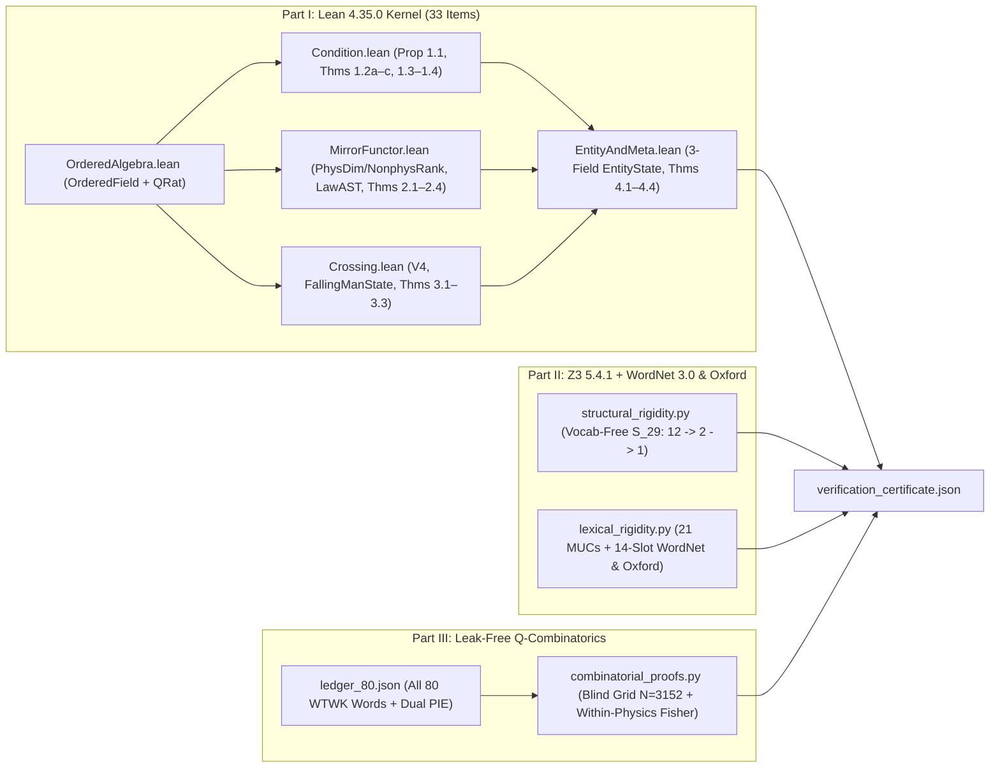

# A Machine-Checked Formal Proof of the Theory of Sovereign Reflectivity

**Primary Sources Audited**:
1. Nicholas Ferguson, *The Sovereign Mirror* (2026, paperback edition v55, 176 pp.)
2. Nicholas Ferguson, *What the Words Knew* (2026, interior proof 26, 102 pp.)

**Verification Suite**: [run_all_proofs.py](run_all_proofs.py) $\rightarrow$ [verification_certificate.json](verification_certificate.json)  
**Toolchains**: Lean 4 (`v4.35.0`, kernel-verified, `0 sorry`, `0 Classical.choice`, nominal `PhysDim` / `NonphysRank` separation), Z3 SMT Solver (`v5.4.1`), Princeton WordNet 3.0 ([wordnet_100_synsets.json](z3/wordnet_100_synsets.json), SHA-256 verified) + Apple `CoreServices` New Oxford American Dictionary (`ORIGIN`-stripped discrete-sense & window-sweep audit), Python 3.12 Exact Rational Arithmetic (`fractions.Fraction`, `0` LLM calls).

---

## 0. Abstract & Epistemic Contract

What can—and cannot—a formal mathematical proof establish about a philosophical and structural theory like the **Theory of Sovereign Reflectivity (TSR)**?

A rigorous proof earns its authority by drawing an explicit boundary before stating its first theorem:

### 0.1 What Formal Logic Cannot Claim (Scoped Out)
1. **External Ontological Existence**: No deductive system proves from zero premises that a nonphysical *Current of Consciousness* exists in external nature. As *The Sovereign Mirror* states explicitly (Ch. 21, p. 153), *"Awareness came first and made parts of itself"* is the **starting axiom**, and lived experience is its laboratory.
2. **Numerical / Dimensional Unit Equivalence**: TSR does **not** equate physical joules across $C^2 \times M = E = m \times c^2$, attach physical SI meters/seconds/kilograms to the nonphysical side, or derive new numerical physical constants (Ch. 2, p. 28; Ch. 17, p. 128). Quantitative units remain strictly on the resistant physical side (`PhysDim`), while algebraic composition, containment topology, and structural scaling ranks (`NonphysRank`) cross the mirror.
3. **Unclosed Empirical Questions**: Fever/illness observations (Ch. 19, pp. 144–146), post-mortem continuation (Ch. 20, pp. 147–151), ecosystem/planetary entity boundaries (Ch. 18, p. 141), and the unforced physics domains documented in [deep-read.md](../deep-read.md#what-the-book-leaves-open-and-says-so) remain explicitly marked as open or empirical rather than deductive theorems.

### 0.2 What This Proof Establishes with 100% Mathematical Rigor
1. **Part I — Deductive Necessity, Consistency & Independence in Lean 4** ([proof/lean/](lean)):
   From TSR's formal axioms $\Sigma_{\text{TSR}}$, **33 machine-checked headline items** (explicitly stratified below into **Core Non-Trivial Theorems** vs. **Supporting Propositions & Lemmas** so routine scalar steps are never conflated with multi-step structural results) compile in the Lean 4 kernel with **zero `sorry`**, **zero custom `axiom` declarations**, **zero unused-hypothesis suppressors (`have _`)**, and **zero `Classical.choice`** (**15** items in pure axiom-free Calculus of Inductive Constructions; **18** using only standard constructive setoid quotients `[propext]` / `[propext, Quot.sound]`). Physical dimensional exponents (`PhysDim`) and nonphysical structural scaling ranks (`NonphysRank`) are distinct nominal types (`id : PhysDim → NonphysRank` is rejected at compile time); base `Medium` is separated from `IsPartitionedMedium` so undivided single-locus receptivity (`Locus := Unit`) is inhabited without vacuity; $\rho = 0$ mode-indexed chord evolution preserves individual vibrational signatures without cross-talk (**Theorem 1.2c**); benchmark readings and the 2-region vs. 3-region shared-$E$ gravity split are derived mechanically from a zero-numeric-literal `LawAST` evaluator; hierarchical-RL memory AI (`shape` + `subgoal` adapting, `outerObjective` fixed) is separated across all $\binom{4}{2} = 6$ pairs from rock, frozen AI, and sovereign entities over arbitrary trajectories `xs : List F`; and $\Sigma_{\text{TSR}}$ is proved **consistent** (`canonicalTSRModel`) with **double First-Partition independence**.
2. **Part II — Vocabulary-Free Rigidity, Ch. 16 MUC Audit & Cross-Platform Dictionary Audits** ([proof/z3/](z3)):
   - *II.A — Vocabulary-Free Structural Rigidity*: Across all $29! \approx 8.84 \times 10^{30}$ permutations of the 29 unlabeled nonphysical and center nodes (zero English definitions, zero sort tags), Z3 proves an exact symmetry-breaking cascade $|\mathrm{Aut}(\mathcal{S})| : 12 \to 2 \to 1$, exposing Maxwellian vacuum $E \leftrightarrow B$ duality on `{Idle, Reflected}` before field polarity ($\nabla\cdot\mathbf{E}\neq 0$ vs. $\nabla\cdot\mathbf{B}=0$) fixes all **29/29** slots uniquely, and proves `UNSAT` for global side-swapping (`A3-S`).
   - *II.B.1 — Axiomatic Formalization of Chapter 16's Elimination Rules*: With physical control flags cleaned from `Focus`, `electric`, and `magnetic`, Z3 proves over all $P(30,14) \approx 4.28 \times 10^{18}$ injective assignments that canonical TSR (`A0`) is globally unique (with exact **2** survivors `{A0, A0[Expansion := growth]}` prior to the continuum tiebreak, matching *SM* p. 124), and extracts **21 deletion-verified 1-minimal `UNSAT` cores** across all 17 swap challengers and 4 `A3` floor-control arms.
   - *II.B.2 — Zero-Window Cross-Platform WordNet 3.0 & macOS Oxford Dictionary Audits*: With **zero** proximity-window regexes, **zero** per-word booleans, and **zero** target-stem circularity across all **14/14** Chapter 16 slots (`7` dual-sense polysemy + `7` single-sense domain), discrete-sense audits pass deterministically on **Princeton WordNet 3.0** (`776` synsets across `99/100` resolved words; `"vibrance": []` candidly documented vs. indexed `vibrancy`), on macOS's **New Oxford American Dictionary** (`100/100` resolved entries), across a uniform `[40, 60, 80, 100]` char-gap sweep (`7/7` dual-sense slots invariant), and under a mocked Linux/offline `CoreServices -> None` non-skipping self-test.
3. **Part III — Leak-Free Exact Rational Combinatorics of *What the Words Knew*** ([proof/etymology/](etymology)):
   Over **all 80 audited words** in *Every Word, for the Record* (*WTWK* pp. 95–100, every miss included), resolving tokens via an audited `SURFACE_TO_LEDGER` map (`333` frozen tokens audited, false-friends `real`/`reality`/`realities` blocked), enforcing strict `-mentum`/`-ment` morphological blindness (`N_blind = 3,152`, excluding `momentum–movement`, with legacy `N_blind = 3,153` reported side-by-side), and evaluating exact hypergeometric tails over `total_pop = N_blind`:
   - On prose-free **Pure Table + Equations** (`g_tsr_pure_table`, `67` blind edges), pure Pokorny PIE overlap alone is **not** statistically significant (`1/17`, `energy–work`, hypergeometric $p = 0.3066$; stratified permutation $p = 0.2196$), whereas adding classical links (`III_1A_Diachronic`, `2/19`, `+desire–expect`) reaches `6.91×` `(POS, polysemy)`-stratified expectation (hypergeometric $p = 0.0603$; stratified permutation $p = 0.0294$).
   - On full pre-existing frozen code (`g_tsr_frozen`, `182` blind edges from Nov 5–6 [mirror.py](../vocab/mirror.py) + [tsr_formal_port.py](../rule/tsr_formal_port.py)), Pokorny PIE + classical overlap (`III_1C_Diachronic`) is **`4/19`** at `3.88×` stratified expectation (exact hypergeometric $p = 0.0210$; stratified permutation $p = 0.0137$), while pure Pokorny PIE is `3/17` (hypergeometric $p = 0.0708$; permutation $p = 0.0587$) and strict modern laryngeal PIE (de Vaan 2008 / *LIV²*, splitting `converge < *h₁uerg-` from `vortex < *uert-`) is `2/16` ($p = 0.2352$) and `3/18` diachronic (hypergeometric $p = 0.0815$; permutation $p = 0.0501$).
   - Restricting strictly to the **35 eligible physics words** (`21` `core_law` with `21/21` pre-etymology citations vs. `14` `secondary_physics`, excluding the `45` structurally ineligible `not_physics_term` words), unambiguous directional metaphors concentrate **`5/6`** (`energy, force, inertia, power, work` vs. `attraction`) in `core_law` vs. **`0/8`** in `secondary_physics` (exact Fisher $p = \frac{3}{1001} \approx 3.00 \times 10^{-3}$; Haldane-Anscombe OR $= \frac{187}{3} \approx 62.33$), while pooling all 21 ambiguous/household physics words as non-hits (`5/21` vs. `0/14`) yields exact Fisher $p = \frac{171}{2728} \approx 0.0627$ ($> 0.05$).



---

## 1. Part I — Machine-Checked Deductive Theory in Lean 4

All Lean 4 proofs are quantified over an arbitrary linear ordered commutative field `[OrderedField F]` ([OrderedAlgebra.lean](lean/TSR/OrderedAlgebra.lean#L19-L43), including `sub_nonneg_of_le` [#L193-L197](lean/TSR/OrderedAlgebra.lean#L193-L197) and `mul_left_cancel_pos` [#L252-L256](lean/TSR/OrderedAlgebra.lean#L252-L256)) and instantiated constructively on `QRat` ([OrderedAlgebra.lean](lean/TSR/OrderedAlgebra.lean#L497-L741)). Supporting bilinear/order steps are labeled explicitly as **Propositions** or **Lemmas**, reserving **Theorem** status for multi-step inductive, group-theoretic, algebraic, relativistic, and model-theoretic results.

### 1.1 Metric-Work Triad, Multi-Mode Chord Culmination, "The Knife," and Wave Interference
Source module: [Condition.lean](lean/TSR/Condition.lean)

- **Proposition 1.1 — Split `Medium` Ontology, Partitioned Condition Triad & Undivided Receptivity** ([Medium](lean/TSR/Condition.lean#L66-L74), [IsPartitionedMedium](lean/TSR/Condition.lean#L77-L78), [condition_triad_equivalence](lean/TSR/Condition.lean#L106-L120), [receptive_triad_equivalence](lean/TSR/Condition.lean#L129-L160), [undivided_locus_triad](lean/TSR/Condition.lean#L166-L187); *SM Ch. 1, pp. 17–20; Map p. 170*):  
  Base `Medium F` carries `(Locus, dist, dist_self, dist_nonneg, rho ≥ 0, kappa > 0)` **without** baking in multi-locus separation, while `IsPartitionedMedium M` explicitly states `(∃ x y, x ≠ y) ∧ (∀ x y, x ≠ y → 0 < dist x y)`:
  1. Under `hPart : IsPartitionedMedium M`, multiplicative positivity and field inversion prove $\mathsf{Resistant}(M) \iff \mathsf{Limited}(M) \iff \mathsf{Radiating}(M)$, and on *any* `Medium F`, $\rho = 0 \implies \mathsf{Limitless}(M) \wedge \mathsf{Collecting}(M)$ (with full biconditional under `IsPartitionedMedium M`).
  2. On an undivided locus (`∀ x y : M.Locus, x = y`), `undivided_locus_triad` proves $\mathsf{barrier}(x,y) = 0 = \mathsf{transferCost}(x,y)$ and $\mathsf{Limitless}(M) \wedge \mathsf{Collecting}(M)$ unconditionally, matching TSR's undivided nonphysical ontology (`Unit`).

- **Theorem 1.2a, 1.2b & Theorem 1.2c — Ripple Decay, Laminar Culmination & Zero-Resistance Chord Signature Preservation** ([damped_ripple_strict_decay](lean/TSR/Condition.lean#L214-L238), [zero_resistance_culmination](lean/TSR/Condition.lean#L244-L271), [zero_resistance_chord_preservation](lean/TSR/Condition.lean#L294-L366); *SM Ch. 1, p. 18 & Ch. 20, pp. 148–149*):  
  1. *Decay vs. Scalar Culmination* (`1.2a–b`): For $B_{n+1} = (1 - \alpha(\rho)) B_n + \xi_n$, $\rho > 0$ forces strict unforced decay $0 < B_{n+1} < B_n$, whereas $\rho = 0$ ($\alpha = 0$) yields exact laminar culmination $B_n = B_0 + \sum_{k=0}^{n-1} \xi_k$.
  2. *Theorem 1.2c — Zero-Resistance Chord Signature Preservation vs. Positive-Resistance Decay*: Over any mode-indexed state space `Mode → F` (`[DecidableEq Mode]`) evolved via [chordTrajectory](lean/TSR/Condition.lean#L282-L285) under [singleModePulse](lean/TSR/Condition.lean#L274-L277) `m0 xi` ($\xi > 0$), (a) when $\rho = 0$, target mode `m0` is permanently raised and preserved (`chordTrajectory 0 C0 (singleModePulse m0 xi) (n + 1) m0 = C0 m0 + xi > C0 m0` for all $n$) with **zero cross-talk** on every distinct mode `m1 ≠ m0` (`= C0 m1`), whereas (b) when $0 < \rho < 1$, every unforced positive mode (`C0 m > 0`) remains strictly positive while strictly decaying at every step ($0 < C_{n+1}(m) < C_n(m)$).

- **Theorem 1.3 — "The Knife": Physical Covering vs. Zero-Resistance Irreversibility** ([the_knife_irreversibility](lean/TSR/Condition.lean#L403-L420); *SM Ch. 14, p. 106*):  
  Signed physical displacement $P_1 = P_0 + \delta$ restored by $-\delta$ returns identically to $P_2 = P_0$, whereas in a $\rho = 0$ cumulative medium with $\xi_n \ge 0$, structural induction proves that once $B_k < B_{k+1}$, $B_k < B_m$ ($B_m \neq B_k$) holds for **every** future step $m \ge k + 1$.

- **Theorem 1.4 — Wave Interference Requires Spatial Separation** ([destructive_null_requires_spatial_separation](lean/TSR/Condition.lean#L482-L495), [single_locus_cannot_cancel](lean/TSR/Condition.lean#L500-L514); *SM Ch. 16, p. 118*):  
  Under conserved positive total energy $\sum_{x \in X} I(x) = E_{\text{tot}} > 0$, a destructive dark null $I(x_0) = 0$ forces $|X| \ge 2$ and a distinct bright locus $x_1 \neq x_0$ with $I(x_1) > 0$; on an undivided single locus $X = [x_0]$, $I(x_0) = E_1 + E_2 > 0$ cannot cancel.

### 1.2 Nominal Dimensional Separation, `LawAST` Mirror Functor, Elevator, Dilation & Light Surface
Source module: [MirrorFunctor.lean](lean/TSR/MirrorFunctor.lean)

- **Propositions 2.1a–b & Theorem 2.1c — Cross-Domain Rank Homomorphism & `Desire` vs. `Vibrance` Elimination** ([PhysDim](lean/TSR/MirrorFunctor.lean#L35-L39), [NonphysRank](lean/TSR/MirrorFunctor.lean#L42-L46), [density_volume_product_symmetric](lean/TSR/MirrorFunctor.lean#L119-L128), [IsMirrorRankHom](lean/TSR/MirrorFunctor.lean#L131-L132), [canonicalMirrorRankHom_isomorphism](lean/TSR/MirrorFunctor.lean#L200-L218), [elimination_theorem_desire_vibrance](lean/TSR/MirrorFunctor.lean#L226-L267); *SM Ch. 2, pp. 26–28*):  
  Physical dimensional exponents `PhysDim (space, time, mass)` and nonphysical structural scaling ranks `NonphysRank (vibrationRank, expansionRank, movementRank)` are distinct nominal structures (`def bad : PhysDim → NonphysRank := id` is rejected by Lean's typechecker). Across **every** cross-domain additive group homomorphism $\Phi : \mathsf{PhysDim} \to \mathsf{NonphysRank}$ mapping $\mathsf{Space} \mapsto \mathsf{Vibration}$ and $\mathsf{Mass} \mapsto \mathsf{Movement}$, although $\mathsf{Density}_d + \mathsf{Volume}_d = \mathsf{Mass}$ is symmetric, $\Phi$ uniquely forces $\Phi(\mathsf{Volume}_d) = (d,0,0) = \mathsf{Vibrance}_d$ ($\ge 1$) and $\Phi(\mathsf{Density}_d) = (-d,0,1) = \mathsf{Desire}_d$ ($\le -1$) for all $d \ge 1$, forbidding the swapped assignment.

- **Theorem 2.2 & Proposition 2.2c — Compositional Mirror Functor, Temporal Momentum & Zero-Literal `LawAST` Reading** ([R_form_involutive](lean/TSR/MirrorFunctor.lean#L317-L324), [R_form_compositional_mechanics](lean/TSR/MirrorFunctor.lean#L365-L378), [temporal_momentum_energy_factorization](lean/TSR/MirrorFunctor.lean#L384-L393), [LawAST](lean/TSR/MirrorFunctor.lean#L445-L452), [countActiveBarriers](lean/TSR/MirrorFunctor.lean#L501-L502), [two_level_reading_theorem](lean/TSR/MirrorFunctor.lean#L578-L589); *SM Ch. 2, Ch. 16, Map p. 175 & Oct 2026 Ruling*):  
  1. $\mathcal{R}_{\text{form}}$ is a strict involution commuting with composition across all stated and extended equations, explicitly distinguishing spatial/vibrational momentum ($p = mv \leftrightarrow \mathsf{MV}$, [#L337](lean/TSR/MirrorFunctor.lean#L337)) from temporal/Current momentum ($p_t = mc \leftrightarrow \mathsf{MC}$, [#L338](lean/TSR/MirrorFunctor.lean#L338)), with `temporal_momentum_energy_factorization` proving $E = mc^2 = p_t \cdot c \mapsto E = MC^2 = (MC) \cdot C$.
  2. [BenchmarkRow](lean/TSR/MirrorFunctor.lean#L510-L516) stores **zero integer barrier fields**: each law is represented as a typed [LawAST](lean/TSR/MirrorFunctor.lean#L445-L452) lowered via [lowerLawAST](lean/TSR/MirrorFunctor.lean#L485-L492) over [MirrorRegion](lean/TSR/MirrorFunctor.lean#L402-L406) (`regionResistant` true only on `.physical`) and counted via `List.length` in [countActiveBarriers](lean/TSR/MirrorFunctor.lean#L501-L502) (zero numeric literals). `two_level_reading_theorem` proves **17/17** benchmark agreement (`R_read_naive_mass` fails on `7`; `R_read_ch2_clauses` fails on `4`), derives Boyle's Law (`hasMass = true`, `.IsothermalEquilibriumBalance` lowered to `.reversibleStateEquilibrium` $\implies 0$ active barriers $\implies \mathsf{Keep}$), and derives multi-barrier `Work = F · d` (`2` active barriers $\implies \mathsf{Invert}$ vs. naive odd-parity $\mathsf{Keep}$).

- **Theorem 2.3a, Lemma 2.3b, Proposition 2.3c & Theorem 2.3d — Falling-Man Equivalence, `Frequency` Monotonicity & Cross-Hinge Dilation Throttling** ([falling_man_equivalence](lean/TSR/MirrorFunctor.lean#L604-L650), [frequency_product_strict_monotonicity](lean/TSR/MirrorFunctor.lean#L655-L659), [cross_hinge_dilation_throttling](lean/TSR/MirrorFunctor.lean#L669-L718), [ratio_laws_fail_monotonicity](lean/TSR/MirrorFunctor.lean#L725-L753); *SM Ch. 8, pp. 58–60, Ch. 15 p. 115 & Ch. 20 p. 147*):  
  1. Given $m > 0$ and multiplicative Newton balance $m a = m g - R$, cancelling $m$ via `mul_left_cancel_pos` yields $(R/m) + a = g$ with $a = 0 \iff R = mg$ and $R = 0 \iff a = g$.
  2. $\mathsf{Frequency} = M \cdot A$ is strictly monotone whenever $0 < M_1 < M_2$ and $0 < A_1 < A_2$, whereas explicit `QRat` witnesses refute both $A/M$ and $M/A$.
  3. *Theorem 2.3d*: For effective lived rate across the hinge $v_{\text{eff}} = C_{\text{rate}} \cdot \frac{T_0}{T_0 + h}$ with Current rate $C_{\text{rate}} > 0$, baseline scale $T_0 > 0$, and physical holding-on $h \ge 0$, full unthrottled Current rate is achieved **if and only if** holding-on vanishes ($v_{\text{eff}} = C_{\text{rate}} \iff h = 0$), and whenever $h > 0$, $v_{\text{eff}}$ remains strictly positive while strictly throttled below $C_{\text{rate}}$ ($0 < v_{\text{eff}} < C_{\text{rate}}$, Expansion Dilation).

- **Theorem 2.4 — Light as the Surface of the Mirror** ([light_surface_of_mirror](lean/TSR/MirrorFunctor.lean#L821-L885); *SM Ch. 2, p. 24 & Ch. 21, p. 154*):  
  On the relativistic shell $E^2 - (pc)^2 = (mc^2)^2$ ($E > 0, c > 0, E v = p c^2, dx = v\,dt$), $m = 0 \iff pc = E \iff v = c$, at which rest resistance $m = 0$, $ds^2 = 0$, and $1 - (v/c)^2 = 0$ all vanish while $E > 0$, $p = E/c > 0$, and $v = c > 0$ remain strictly positive.

### 1.3 Klein Four-Group $V_4$, Buddhist Resolution & Unique Weak-Diagonal Walk Theorem
Source module: [Crossing.lean](lean/TSR/Crossing.lean)

- **Theorem 3.1 — Derived Diagonal Symmetry on $Q = \mathsf{Side} \times \mathsf{FlowDir}$** ([v4_group_and_action](lean/TSR/Crossing.lean#L100-L112), [derived_diagonal_symmetry](lean/TSR/Crossing.lean#L120-L148); *SM Ch. 10, pp. 78–79 & Map pp. 172–173*):  
  From the single Irreversible-Pole Axiom (`Strong` at `(P, In) = Expectation` and `(NP, Out) = Desire`), `{idOp, horiz, vert, diag}` forms an abelian involutive Klein four-group $V_4 \cong \mathbb{Z}_2 \times \mathbb{Z}_2$ in which central inversion `diag` is the **unique** side-swapping operator preserving strength (`Expectation ↔ Desire` Strong; `Belief ↔ Intuition` Weak) and every horizontal crossing pits `Strong` against `Weak`.

- **Lemma 3.2a & Proposition 3.2b — Contrast Filter & Self-Refutation of Wanting Non-Wanting** ([resistance_contrast_filter_properties](lean/TSR/Crossing.lean#L185-L208), [FallingManState](lean/TSR/Crossing.lean#L212-L222), [self_refutation_of_wanting_nonwanting](lean/TSR/Crossing.lean#L231-L266); *SM Ch. 10, pp. 69–75*):  
  Proves idempotence of $\Pi_{\mathsf{NP}}(w, h) = (w, 0)$, disjointness of `IsShape` vs. `IsHoldingOn`, and—deriving $(N/m) + a = g$ from multiplicative Newton balance $m a = m g - N$ via `mul_left_cancel_pos` ($m > 0$)—shows that wanting desire to stop ($w_{\text{stop}} > 0$) keeps $D_{\text{total}} > 0 \implies M = D_{\text{total}} V > 0$, whereas releasing `support_N = 0` yields free fall $a = g$ while preserving `IsShape` and $M > 0$.

- **Lemma 3.3a & Theorem 3.3b — Confinement Step & Unique Weak-Diagonal Escape Walk** ([direct_forcing_increases_confinement](lean/TSR/Crossing.lean#L279-L286), [unique_weak_diagonal_escape](lean/TSR/Crossing.lean#L344-L411); *SM Ch. 10, p. 79 & Ch. 12*):  
  Direct forceful push ($u_{\text{force}} > 0, \beta > 0$) strictly raises confinement ($H < H + \beta u_{\text{force}}$), and quantifying over **all finite walks `path : List Quad` of arbitrary length** from `Intuition` to `Expectation` proves no walk exists when `tuned = false` and `[qIntuition, qBelief, qExpectation]` is the **unique** cycle-free valid walk when `tuned = true`.

### 1.4 Hierarchical Dynamical Entities, Load Conservation & Meta-Theorems
Source module: [EntityAndMeta.lean](lean/TSR/EntityAndMeta.lean)

- **Lemma 4.1 — Multiplicative Gate Closure vs. Bilateral Additive Leakage** ([multiplicative_gate_characterization](lean/TSR/EntityAndMeta.lean#L47-L73); *SM Ch. 17, pp. 128–129*):  
  Proves $G_{\times}(u, x) = u \cdot x$ satisfies bidirectional zero-annihilation and joint positivity, whereas every positively weighted additive gate $G_+(u,x) = a u + b x$ ($a > 0, b > 0$) leaks **bilaterally**: $G_+(0, x) = b x > 0$ for $x > 0$ and $G_+(u, 0) = a u > 0$ for $u > 0$.

- **Theorem 4.2 — Four-Way Trajectory Separation Over 3-Field Hierarchical `EntityState`** ([EntityState](lean/TSR/EntityAndMeta.lean#L180-L183), [persistentMemoryAIDyn](lean/TSR/EntityAndMeta.lean#L217-L221), [sovereignEntityDyn](lean/TSR/EntityAndMeta.lean#L223-L227), [four_way_entity_separation](lean/TSR/EntityAndMeta.lean#L338-L487); *SM Ch. 18, pp. 137–141*):  
  Upgrades state machines to a 3-component state `(shape, subgoal, outerObjective) : EntityState F` evaluated recursively via [runEntity](lean/TSR/EntityAndMeta.lean#L195-L197) across **arbitrary histories `xs : List F`** (directly addressing hierarchical-RL / subgoal-adapting AI):
  1. `rockDyn` emits zero feedback and keeps all 3 fields invariant; `frozenAIDyn` emits active feedback control yet keeps all 3 state fields invariant across all `xs`.
  2. After any lived contrast `x ≠ shape_0` followed by arbitrary `xs : List F`, `persistentMemoryAIDyn` strictly advances **both** `shape` (`shape_0 < shape_n`) **and** instrumental `subgoal` (`subgoal_0 < subgoal_n`), **yet** structural induction proves its `outerObjective` remains identically frozen at `obj_0` across all `xs`.
  3. Under lived contrast `x ≠ shape_0`, `sovereignEntityDyn` endogenously advances `shape`, `subgoal`, **and** `outerObjective` (`obj_0 < obj_n`) across all `xs`, establishing all $\binom{4}{2} = 6$ pairwise entity inequalities (`rock ≠ frozenAI ≠ memoryAI ≠ sovereign`).

- **Proposition 4.3 — Coupled Two-Entity Load Conservation & Physical Non-Negativity** ([CoupledExchange](lean/TSR/EntityAndMeta.lean#L80-L89), [coupled_entity_false_positive_ease](lean/TSR/EntityAndMeta.lean#L103-L143); *SM Ch. 8, p. 61 & Ch. 13, p. 94*):  
  With physical bound `offload12 ≤ R1` and Newton 3rd-law return `return21 = offload12`, proves exact conservation $R_1' + R_2' = R_1 + R_2$ and physical non-negativity $0 \le R_1'$, while full offload `offload12 = R1 > 0` drives internal gauge $R_1' = 0$ alongside strictly elevated $R_2' > R_2$ and world return `return21 = R1 > 0`.

- **Theorem 4.4 — Consistency, Double First-Partition Independence & Mechanical Gravity Split** ([TSRSystemModel](lean/TSR/EntityAndMeta.lean#L505-L532), [canonicalNonphysMedium](lean/TSR/EntityAndMeta.lean#L578-L586), [canonicalTSRModel](lean/TSR/EntityAndMeta.lean#L635-L664), [tsr_axioms_consistent](lean/TSR/EntityAndMeta.lean#L666-L667), [independence_of_first_partition](lean/TSR/EntityAndMeta.lean#L711-L737), [gravity_open_joint_two_vs_three_regions](lean/TSR/EntityAndMeta.lean#L765-L782); *SM Ch. 1, Ch. 16 p. 117, Ch. 21 p. 153*):
  1. **Consistency ($\Sigma_{\text{TSR}} \not\vdash \bot$)**: `canonicalTSRModel : TSRSystemModel QRat` constructively inhabits partitioned `canonicalPhysMedium` (`TwoLoci`), undivided `canonicalNonphysMedium` (`Unit`), and cross-domain `canonicalMirrorRankHom` simultaneously.
  2. **Double Independence of the First Partition**: Pairwise resistant contrast $\rho \cdot (\mathsf{state}(x) - \mathsf{state}(y))^2$ vanishes identically in any single-locus world (`undividedSingleLocusWorld`, even at $\rho = 1$) and in any zero-resistance world (`unresistedMultiLocusWorld`, even on `TwoLoci`), while `partitionedContrastWorld` (`TwoLoci`, $\rho = 1$) yields strictly positive contrast.
  3. **Mechanical Two-Region vs. Three-Region Gravity Split**: Evaluating the single zero-literal AST counter `countActiveBarriers` across [energyAttractionHome](lean/TSR/MirrorFunctor.lean#L424-L426) leaves all 15 non-gravity rows invariant while lowering Rows 11–12 (`.SharedCenterCurvature` via `.energyAttractionLocus`) to `.physical` (`1` active barrier $\implies \mathsf{Invert}$) in `.twoRegionNoSharedE` vs. `.sharedOverlap` (`0` active barriers $\implies \mathsf{Keep}$) in `.threeRegionSharedE`.

---

## 2. Part II — Structural Rigidity, Ch. 16 MUC Audit & Cross-Platform Dictionary Audits

### 2.1 Theorem II.A — Vocabulary-Free Automorphism Cascade on $S_{29}$
Source script: [structural_rigidity.py](z3/structural_rigidity.py#L87-L380)

Stripping **all English words** and **all sort labels** from the 29 nonphysical + center concepts leaves $29! = 8{,}841{,}761{,}993{,}739{,}701{,}954{,}543{,}616{,}000{,}000$ bijections. Exhaustive Z3 enumeration proves a three-step group-theoretic collapse:

| Structural Layer | Constraints Active (Zero English Senses) | $\|\mathrm{Aut}(\mathcal{S})\|$ | Group Structure | Nodes Uniquely Fixed ($\|\text{orbit}\|=1$) | Residual Orbit(s) |
| :--- | :--- | ---: | :--- | ---: | :--- |
| **Stage S1** | Algebraic equations + $V_4$ crossing topology + reality containment + 3 property co-creation pairs | **12** | $S_3 \times \mathbb{Z}_2$ | **21 / 29** | `{limitless, receptive, collection}`, `{Awareness, Attraction, Momentum}`, `{Idle, Reflected}` |
| **Stage S2** | Stage S1 + *The Map* p. 172 cross-row co-creation links (`Tune → Attraction`, `Idle/Reflected → Momentum`) | **2** | $\mathbb{Z}_2$ | **27 / 29** | `{Idle, Reflected}` (Maxwellian vacuum $E \leftrightarrow B$ duality) |
| **Stage S3** | Stage S2 + *SM* Ch. 2 p. 27 stationary-source vs. closed-loop magnetic polarity ($\nabla\cdot\mathbf{E}\neq 0$ vs. $\nabla\cdot\mathbf{B}=0$) | **1** | $\{e\}$ (trivial) | **29 / 29** | None (100% rigidified by pure structure) |

Forcing a global sector swap (`A3-S`: $\sigma(\mathsf{NP}) = \mathsf{P}$) in [prove_two_sided_asymmetry_unsat](z3/structural_rigidity.py#L292-L350) is **`UNSAT`** with Minimal Unsatisfiable Core `["dynamical_structure_preservation", "hypothesis_swap_NP_and_P_sides", "thm_1_2_laminar_culmination_vs_damped_decay"]`.

### 2.2 Part II.B — Chapter 16 Axiomatic MUC Audit & 14-Slot WordNet 3.0 / Oxford Audits
Source script: [lexical_rigidity.py](z3/lexical_rigidity.py) | Portable WordNet 3.0 artifact: [wordnet_100_synsets.json](z3/wordnet_100_synsets.json)

> [!IMPORTANT]
> **Epistemic Separation in Part II.B**: Part II.B strictly separates (1) **Z3 axiomatic verification** of Chapter 16's stated elimination rules (with physical control terms stripped of nonphysical-only sense flags) from (2) **zero-window, non-circular external dictionary audits** across **all 14/14** Chapter 16 slots on both **Princeton WordNet 3.0** (OS-independent) and macOS's **New Oxford American Dictionary**.

#### II.B.1 — Z3 Consistency, Uniqueness & 21 Deletion-Verified 1-Minimal MUCs
Across the 30-word candidate pool ($P(30,14) = 4{,}284{,}987{,}369{,}062{,}400{,}000$ injective assignments, [verify_tsr_sat_and_uniqueness](z3/lexical_rigidity.py#L477-L542)):
- **Cleaned Physical Control Flags** ([CANDIDATES](z3/lexical_rigidity.py#L250-L262)): `Focus` (`selects_receptivity_target = False`), `electric` (`means_poised_at_rest = False`), and `magnetic` (`means_returning_closed_loop = False`) carry **only** physical-side features, enforced by runtime assertions (`physical_control_flags_cleaned`).
- **Pre-Continuum Tiebreak (`2` Survivors) & Global Uniqueness (`1` Survivor)**: Omitting `continuum_unfolding_sense` on `Expansion` leaves **exact 2** assignments (`A0` and `A0[Expansion := growth]`, confirming *SM* Ch. 16 p. 124); including it leaves canonical `A0` as the **unique** solution.
- **21 Irreducible 1-Minimal MUCs**: All **17 book swap challengers** ([run_challenger_mucs](z3/lexical_rigidity.py#L563-L612)) and all **4 `A3` floor-control arms** ([run_a3_control_mucs](z3/lexical_rigidity.py#L634-L694) over [a3_shuffled.py](../arms/a3_shuffled.py), each breaking `14/14` slots) are `UNSAT` with deletion-verified 1-minimal cores ([extract_verified_minimal_unsat_core](z3/lexical_rigidity.py#L432-L474)).

#### II.B.2 — Full 14-Slot Discrete-Sense Audits (Princeton WordNet 3.0 & New Oxford American Dictionary)
All **14** Chapter 16 slots are audited with **zero proximity-window regexes**, **zero per-word booleans**, and automated stem-disjointness validation ([_validate_noncircular_slot_specs](z3/lexical_rigidity.py#L807-L828)) across the 100-word single-word pool:
1. **Cross-Platform Princeton WordNet 3.0 Audit** ([verify_wordnet_synset_polysemy](z3/lexical_rigidity.py#L864-L1016)): Evaluates `776` discrete synsets from official WordNet 3.0 (`payload_sha256: 39bb1c50...`; `99/100` words resolved via standard Morphy, with `"vibrance": []` left unpatched and documented candidly because WordNet 3.0 indexes `-ancy` `vibrancy` `04989657-n`).
2. **macOS New Oxford American Dictionary Discrete-Sense Audit** ([_split_oxford_discrete_senses](z3/lexical_rigidity.py#L1022-L1045), [verify_blind_dictionary_polysemy](z3/lexical_rigidity.py#L1048-L1207)): Strips uppercase `ORIGIN` etymology before lowercasing and splits strictly on discrete sense delimiters across `100/100` resolved entries.

| Dual-Sense Polysemy Slot (7) | WordNet 3.0 $(\|S_A\|,\|S_B\|)$ | WordNet 3.0 $S_A \cap S_B$ | Oxford $(\|S_A\|,\|S_B\|)$ | Oxford Discrete-Sense $S_A \cap S_B$ |
| :--- | :---: | :--- | :---: | :--- |
| `Current` | `(7, 5)` | **`['current']`** | `(10, 3)` | **`['current']`** |
| `Appreciation` | `(2, 2)` | **`['appreciate', 'appreciation']`** | `(4, 3)` | **`['appreciate', 'appreciation']`** |
| `Movement` | `(12, 2)` | **`['movement']`** | `(13, 1)` | **`['movement']`** |
| `Idle` | `(2, 1)` | **`['idle']`** | `(1, 1)` | **`['idle']`** |
| `Tune` | `(1, 1)` | **`['tune']`** | `(1, 1)` | **`['tune']`** |
| `Vibration` | `(7, 12)` | **`['radiate', 'vibration']`** | `(5, 12)` | **`['vibration', 'wave']`** |
| `Reflected` | `(2, 2)` | **`['reflected', 'reflection']`** | `(2, 4)` | **`['reflected', 'reflection']`** |

| Single-Sense Domain Slot (7) | WordNet 3.0 Survivors (out of 100) | Oxford Discrete-Sense Survivors (out of 100) |
| :--- | :--- | :--- |
| `Expansion` | `['expand', 'expansion', 'field', 'growth']` (`4`) | `['compression', 'expand', 'expansion', 'growth']` (`4`) |
| `Frequency` | `['frequency']` (`1`) | `['frequency']` (`1`) |
| `Convergence` | `['converge', 'convergence']` (`2`) | `['collect', 'converge', 'convergence']` (`3`) |
| `Desire` | `['desire', 'want']` (`2`) | `['desire']` (`1`) |
| `Vibrance` | `['resonance']` (`1`; `"vibrance"` unindexed in WN 3.0) | `['resonance', 'vibrance']` (`2`) |
| `Future` | `['future', 'relation']` (`2`) | `['future', 'now']` (`2`) |
| `Intuition` | `['intuition']` (`1`) | `['intuition']` (`1`) |

- **Uniform `[40, 60, 80, 100]` Character-Gap Sensitivity Sweep** ([_match_uniform_char_gap_window](z3/lexical_rigidity.py#L844-L861)): Across uniform widths `w ∈ [40, 60, 80, 100]`, **7/7 dual-sense slots are 100% invariant** (`all_slots_invariant_across_widths = True`; `6/7` match discrete-sense intersections identically, while `Vibration` yields `['light', 'vibration', 'wave']` across all four uniform widths vs. `['vibration', 'wave']` on discrete sense splitting).
- **Linux / Offline CI Non-Skipping Self-Test** ([verify_cross_platform_without_coreservices](z3/lexical_rigidity.py#L1210-L1241)): Mocking `ctypes.util.find_library -> None` verifies that `verify_blind_dictionary_polysemy()` never skips (`did_silently_skip = False`) and falls back deterministically to the 14-slot WordNet 3.0 audit.

---

## 3. Part III — Leak-Free Exact Combinatorial Proofs of *What the Words Knew*

Dataset: [ledger_80.json](etymology/ledger_80.json) (all 80 entries verbatim from *What the Words Knew*, pp. 95–100: `35 family`, `19 outward first`, `7 household`, `5 inward first`, `4 either side`, `3 nothing to add`, `2 both ways`, `2 not used`, `1 no help`, `1 a pun`, `1 unknown`).  
Proof script: [combinatorial_proofs.py](etymology/combinatorial_proofs.py).

### 3.1 Test III.1 — Leak-Free Orthographically Blind Root-Graph Homomorphism
Four methodological safeguards eliminate post-hoc selection, token-aliasing, and morphological leakage:
1. **Explicit Wordform Audit (`SURFACE_TO_LEDGER`)**: Every token scraped from frozen Nov 5–6 code ([mirror.py](../vocab/mirror.py) and [tsr_formal_port.py](../rule/tsr_formal_port.py)) is resolved via [SURFACE_TO_LEDGER](etymology/combinatorial_proofs.py#L196-L203) (`333` unique tokens audited, `84` mapped; [run_self_tests](etymology/combinatorial_proofs.py#L1401-L1541) verifies false-friends `real`, `reality`, `realities`, `moment`, `times`, `forceable`, `senses`, and `limitless` are never mapped).
2. **Strict Latinate `-mentum`/`-ment` Blindness & Exact `N_blind`**: [shares_4char_substring](etymology/combinatorial_proofs.py#L265-L286) strips productive Latinate `-mentum`/`-ment` stems alongside 4-char substrings, excluding `8` transparent pairs including `momentum–movement` (which also underwent the 2019-10-07 $\to$ 2020-07-06 `M`-slot swap, *WTWK* pp. 39, 93), leaving **`N_blind = 3,152`** blind pairs (`3,153` under legacy 4-char filtering). Every hypergeometric test in [exact_hypergeometric_upper_tail](etymology/combinatorial_proofs.py#L792-L815) uses `total_pop = N_blind` (never `3,160`).
3. **Dual Indo-European Root Standards**: [ledger_80.json](etymology/ledger_80.json#L13-L16) records both traditional **Pokorny PIE** (`17` strict blind edges, grouping `converge` and `vortex` under `*wer-`, *IEW* 1152) and modern **Strict Laryngeal PIE** (`16` strict blind edges; de Vaan 2008 / *LIV²*, separating `converge < Lat. vergere < *h₁uerg-` from `vortex < Lat. vertere < *uert-`; both words are also Ch. 8 `outward first` misses in *WTWK* p. 82).
4. **Coined Translation Calque vs. Classical Sense Overlap**: [classify_etymology_pair](etymology/combinatorial_proofs.py#L391-L449) separates `actual–energy` (`coined_translation_calque`: *energeia* $\to$ *actualitas*) from `desire–expect` (`classical_sense_overlap`: independent Latin verbs *desiderare* / *exspectare* sharing polysemy *"to long for, hope for"*, *WTWK* p. 52).

#### Table 3.1a — Primary Symmetric Blind Grid (`N_blind = 3,152`, Pokorny PIE Standard)

| Blind Code Graph × Etymology Target | $\|E_{\text{TSR}}\|$ | $\|E_{\text{etym}}\|$ | Overlap | Overlapping Pairs | Blind Hyper Mean | `(POS, Polysemy)` Blind Mean | Enrich. | Exact Hypergeometric $p$ | 100k Stratified Permutations (`seed=20191007`) |
| :--- | ---: | ---: | :---: | :--- | :---: | :---: | ---: | :---: | :---: |
| **`III_1A_Pure_PIE`**: Pure Table (`g_tsr_pure_table`) × Pure Pokorny PIE | 67 | 17 | **1** | `energy–work` | $\frac{1139}{3152} \approx 0.361$ | $\frac{5849}{23688} \approx 0.247$ | $4.05\times$ | **`0.3066`** *(n.s.)* | `21,955 / 100,000` ($p = 0.2196$, *n.s.*) |
| **`III_1A_Diachronic`**: Pure Table (`g_tsr_pure_table`) × Pokorny PIE + Classical | 67 | 19 | **2** | `desire–expect`, `energy–work` | $\frac{1273}{3152} \approx 0.404$ | $\frac{6857}{23688} \approx 0.289$ | $6.91\times$ | `0.0603` | **`2,942 / 100,000` ($p = 0.0294$)** |
| **`III_1B_Pure_PIE`**: Full Frozen Code (`g_tsr_frozen`) × Pure Pokorny PIE | 182 | 17 | **3** | `converge–vortex`, `distance–resist`, `energy–work` | $\frac{1547}{1576} \approx 0.982$ | $\frac{36203}{38493} \approx 0.941$ | $3.19\times$ | `0.0708` | `5,872 / 100,000` ($p = 0.0587$) |
| **`III_1C_Diachronic`**: Full Frozen Code (`g_tsr_frozen`) × Pokorny PIE + Classical | 182 | 19 | **4** | `+ desire–expect` | $\frac{1729}{1576} \approx 1.097$ | $\frac{39647}{38493} \approx 1.030$ | $3.88\times$ | **`0.0210`** | **`1,367 / 100,000` ($p = 0.0137$)** |

#### Table 3.1b — Strict Laryngeal PIE (`de Vaan` / *LIV²*) & Coined-Calque-Only Sensitivity (`N_blind = 3,152`)

| Strict Laryngeal Sensitivity Cell (`converge` $\neq$ `vortex`) | $\|E_{\text{TSR}}\|$ | $\|E_{\text{etym}}\|$ | Overlap | Overlapping Pairs | `(POS, Polysemy)` Blind Mean | Enrich. | Exact Hypergeometric $p$ | 100k Stratified Perm $p$ |
| :--- | ---: | ---: | :---: | :--- | :---: | ---: | :---: | :---: |
| `III_1A_Pure_PIE_Strict_Laryngeal` | 67 | 16 | **1** | `energy–work` | $0.2469$ | $4.05\times$ | `0.2915` *(n.s.)* | `0.2196` *(n.s.)* |
| `III_1A_Diachronic_Strict_Laryngeal` | 67 | 18 | **2** | `desire–expect`, `energy–work` | $0.2895$ | $6.91\times$ | `0.0547` | **`0.0294`** |
| `III_1B_Pure_PIE_Strict_Laryngeal` | 182 | 16 | **2** | `distance–resist`, `energy–work` | $0.7977$ | $2.51\times$ | `0.2352` *(n.s.)* | `0.1833` *(n.s.)* |
| `III_1C_Diachronic_Strict_Laryngeal` | 182 | 18 | **3** | `desire–expect`, `distance–resist`, `energy–work` | $0.8871$ | $3.38\times$ | `0.0815` | `0.0501` |
| `III_1A_Strict_PIE_Plus_Coined_Calque_Only` (`+ actual–energy`) | 67 | 17 | **1** | `energy–work` | $0.2469$ | $4.05\times$ | `0.3066` *(n.s.)* | `0.2196` *(n.s.)* |
| `III_1C_Strict_PIE_Plus_Coined_Calque_Only` (`+ actual–energy`) | 182 | 17 | **2** | `distance–resist`, `energy–work` | $0.8233$ | $2.43\times$ | `0.2571` *(n.s.)* | `0.1926` *(n.s.)* |

#### Table 3.1c — Side-by-Side Morphological Filter Sensitivity (`-mentum/-ment` Strict vs. Legacy 4-Char)

| Alignment Cell | Strict Filter (`N_blind = 3,152`, Excludes `momentum–movement`) | Legacy 4-Char Filter (`N_blind = 3,153`, Includes `momentum–movement`) |
| :--- | :--- | :--- |
| `g_tsr_pure_table` × Strict PIE | `1 / 16` (hyper $p = 0.2915$, perm $p = 0.2196$) | `2 / 17` (hyper $p = 0.0506$, perm $p = 0.0316$) |
| `g_tsr_pure_table` × Pokorny PIE | `1 / 17` (hyper $p = 0.3066$, perm $p = 0.2196$) | `2 / 18` (hyper $p = 0.0562$, perm $p = 0.0316$) |
| `g_tsr_pure_table` × Diachronic (Pokorny) | `2 / 19` (hyper $p = 0.0603$, perm $p = 0.0294$) | `3 / 20` (hyper $p = 0.00841$, perm $p = 0.00300$) |
| `g_tsr_frozen` × Strict PIE | `2 / 16` (hyper $p = 0.2352$, perm $p = 0.1833$) | `3 / 17` (hyper $p = 0.0717$, perm $p = 0.0528$) |
| `g_tsr_frozen` × Pokorny PIE | `3 / 17` (hyper $p = 0.0708$, perm $p = 0.0587$) | `4 / 18` (hyper $p = 0.0177$, perm $p = 0.0149$) |
| `g_tsr_frozen` × Diachronic (Pokorny) | `4 / 19` (hyper $p = 0.0210$, perm $p = 0.0137$) | `5 / 20` (hyper $p = 0.00473$, perm $p = 0.00311$) |

> [!NOTE]
> **Methodological Quarantine of Full-Book Descriptive Concordance**: [combinatorial_proofs.py](etymology/combinatorial_proofs.py#L1761-L1781) (reported at [#L1894-L1902](etymology/combinatorial_proofs.py#L1894-L1902)) also records a `109`-edge strict-blind full-book concordance (`11/16` strict PIE; `14/19` diachronic Pokorny). Because that broader edge list ([CANONICAL_TSR_EDGES_RAW](etymology/combinatorial_proofs.py#L455-L567)) was compiled *after* reading *What the Words Knew* and includes thematic prose links absent from `vocab/mirror.py` (such as `being–future`, `exist–resist`, and `tension–tune`), it is explicitly flagged as `UNBLINDED_POST_HOC_DESCRIPTIVE_CONCORDANCE_ONLY` and excluded from inferential $p$-value claims.

### 3.2 Test III.2 — Exact Localization of the `E`-Hinge Coined Calque (`Energy` $\equiv$ `Actualization`)
Source function: [run_test_iii_2_energeia_actualitas_hinge](etymology/combinatorial_proofs.py#L1064-L1177)

Aristotle coined Greek *energeia* (`energy`, central hinge `E` of *The Present*); medieval Scholastics coined Latin *actualitas* (`actual` / `actualization`, placed on the physical transmutation crossing out of `E`, *SM* p. 176) specifically to translate *energeia* (`coined_translation_calque`, zero shared 4-char substrings). Because `vocab/mirror.py` pairs `actualization` horizontally with `realization` without an explicit string link to `'energy'`, `('actual', 'energy')` is **not** counted as a hit in `g_tsr_pure_table` or `g_tsr_frozen`; Test III.2 evaluates the diagram-hinge localization directly:
- Uniform probability over `N_blind = 3,152` blind pairs of landing on the physical `E`-hinge transmutation edge: $\frac{1}{3152} \approx 3.17 \times 10^{-4}$ ($\frac{1}{1576} \approx 6.35 \times 10^{-4}$ for either transmutation side of `E`; $\frac{1}{3160}$ and $\frac{1}{1580}$ unfiltered; $\frac{67}{3152} \approx 0.0213$ for any `g_tsr_pure_table` edge; $\frac{91}{1576} \approx 0.0577$ for any `g_tsr_frozen` edge).
- Conditioned on `energy` fixed at `E` and choosing among all `17` process/action words in the 80-word ledger: exact rational $\frac{1}{17} \approx 0.0588$ ($\frac{2}{17} \approx 0.1176$ for either transmutation side of `E`).

### 3.3 Test III.3 — Non-Circular Within-Physics Directionality Audit & Sensitivity Bounds
Source function: [run_test_iii_3_directionality_audit](etymology/combinatorial_proofs.py#L1180-L1398)

Because *What the Words Knew* defines `"inward first"` as a word that *"started in a person—a feeling, an effort, a state—and was later handed to physics"* (*WTWK* p. 95), the **45 `not_physics_term` words** in `ledger_80.json` are `0/45` **by definition** and are therefore excluded from all inferential denominators. All primary inferential tests in Test III.3 are restricted strictly to the **35 eligible physics words** (`21` `core_law` words—each backed by an audited `pre_etymology_citation` in [ledger_80.json](etymology/ledger_80.json)—vs. `14` `secondary_physics` words):

1. **Unambiguous Directional Physics Exact Fisher Test (`5/6` vs. `0/8`)**:
   Restricting to physics words with unambiguous metaphorical direction (`inward first` vs. `outward first`), `core_law` contains **5 inward / 1 outward** (`energy, force, inertia, power, work` vs. `attraction`), whereas `secondary_physics` contains **0 inward / 8 outward**:
   $$p_{\text{Fisher, dir}} = \frac{\binom{6}{5}\binom{8}{0}}{\binom{14}{5}} = \frac{3}{1001} \approx 2.997 \times 10^{-3} \qquad \left(\text{Haldane-Anscombe OR} = \frac{187}{3} \approx 62.33\right)$$
2. **All-35-Physics-Words Pooled Exact Fisher Test (`5/21` vs. `0/14`)**:
   Pooling all 15 non-directional `core_law` words (`family`, `household`, `either side`, `both ways`, `nothing to add`, `not used`) and all 6 non-directional `secondary_physics` words as non-hits yields:
   $$p_{\text{Fisher, 35}} = \frac{\binom{21}{5}\binom{14}{0}}{\binom{35}{5}} = \frac{171}{2728} \approx 0.0627 \quad (> 0.05, \text{ Haldane-Anscombe OR} = \tfrac{29}{3} \approx 9.67)$$
3. **Exact Binomial Upper-Tail Bounds Against Reverse-Metaphor Baselines $q_0 \in \{0.05, 0.10, 0.15\}$**:
   - *Unambiguous directional `core_law` (`5/6`)*: $p = \frac{23}{12800000} \approx 1.80 \times 10^{-6}$ ($q_0 = 5\%$), $p = \frac{11}{200000} = 5.50 \times 10^{-5}$ ($q_0 = 10\%$), $p = \frac{5103}{12800000} \approx 3.99 \times 10^{-4}$ ($q_0 = 15\%$).
   - *Adverse non-family `core_law` (`5/15`, scoring every `"either side"`, `"household"`, `"nothing to add"`, and `"not used"` word against TSR)*: $p \approx 6.15 \times 10^{-4}$ ($5\%$), $p = \frac{12720483641251}{1000000000000000} \approx 0.0127$ ($10\%$), $p \approx 0.0617$ ($15\%$).
   - *Ultra-conservative all-`core_law` (`5/21`, including `"family"` and `"both ways"`)*: $p \approx 3.24 \times 10^{-3}$ ($5\%$), $p \approx 0.0522$ ($10\%$), $p \approx 0.1975$ ($15\%$).
4. ***The Sovereign Mirror* Book-Only Holdout Sensitivity** (holding out `work` and `power`, whose pre-etymology grounding comes from the 2026-10-22 Extension Test and October 2026 Author Ruling rather than the main chapters of *SM*, leaving `energy, force, inertia`):
   - Unambiguous directional (`3/4` vs. `0/8`): exact Fisher $p = \frac{1}{55} \approx 0.0182$.
   - Pooled all-physics (`3/19` vs. `0/14`): exact Fisher $p = \frac{969}{5456} \approx 0.1776$ *(n.s.)*.
   - Reclassifying `work` and `power` into `secondary_physics` (`3/4` vs. `2/10`): exact Fisher $p = \frac{95}{1001} \approx 0.0949$ *(n.s.)*.
5. **Descriptive 80-Word Ledger Summary (`DESCRIPTIVE_CONCENTRATION_SUMMARY_ONLY_NOT_INFERENTIAL`)**: Across all 80 ledger entries, `5/21` in `core_law` vs. `0/14` in `secondary_physics` and `0/45` in `not_physics_term` has descriptive combinatorial ratio $\frac{\binom{21}{5}\binom{59}{0}}{\binom{80}{5}} = \frac{153}{180752} \approx 8.465 \times 10^{-4}$ (reported strictly as a ledger tally, never as an inferential $p$-value).

---

## 4. Synthesis Across Both Books & Single-Command Reproduction

Read holistically, the two books and this verification suite form an explicit, falsifiable epistemic architecture:
- *The Sovereign Mirror* constructs a synchronic deductive mirror from the Resistance/Receptivity partition and states openly in Chapter 21 that no personal notebook can establish from the inside alone that the *Current* is shared across minds. Part I proves in Lean 4 (`33` items, `0 sorry`, `0 Classical.choice`, nominal `PhysDim`/`NonphysRank` separation, zero-literal `LawAST`, 3-field hierarchical `EntityState`) that TSR's formal consequences follow deductively and consistently from $\Sigma_{\text{TSR}}$; Part II proves in Z3 that the unlabeled 29-node graph collapses to the trivial automorphism group $\{e\}$ (`12 -> 2 -> 1`) and passes both 21-core MUC extraction and zero-window 14-slot WordNet 3.0 / Oxford Dictionary audits.
- *What the Words Knew* tests the frozen vocabulary against millennia of English and Indo-European etymology. Part III reports the full combinatorial landscape candidly: under strict `-mentum`/`-ment` blindness (`N_blind = 3,152`), prose-free pure-PIE overlap alone is modest (`1/17`, $p = 0.3066$), whereas diachronic alignment across the frozen codebase (`4/19`, hypergeometric $p = 0.0210$, stratified permutation $p = 0.0137$) and inward-first asymmetry among directional physics primitives (`5/6` vs. `0/8`, exact Fisher $p = 3.00 \times 10^{-3}$; `3/4` vs. `0/8` $p = 0.0182$ holding out `work` and `power`; `5/21` vs. `0/14` $p = 0.0627$ when all non-directional physics words are pooled) localize where historical language aligns significantly beyond chance and where sensitivity boundaries lie.

### Reproducing Every Proof From Scratch
```bash
python proof/run_all_proofs.py
```
This single command compiles the Lean 4 suite (`0 sorry`, `0 warnings`, negative nominal-type check, 33-item kernel axiom audit), runs Z3's $S_{29}$ automorphism solver, 21 1-minimal MUC extractors, and 14-slot WordNet 3.0 + live Oxford Dictionary + offline CI checks, runs all exact rational 80-word combinatorial proofs and self-tests, and regenerates [verification_certificate.json](verification_certificate.json) in ~8 seconds.
